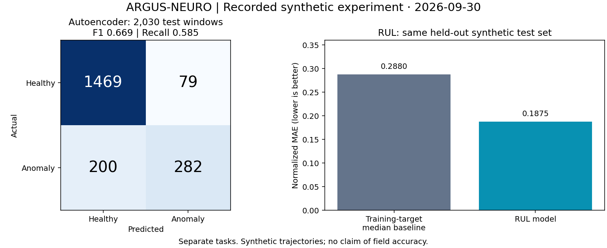
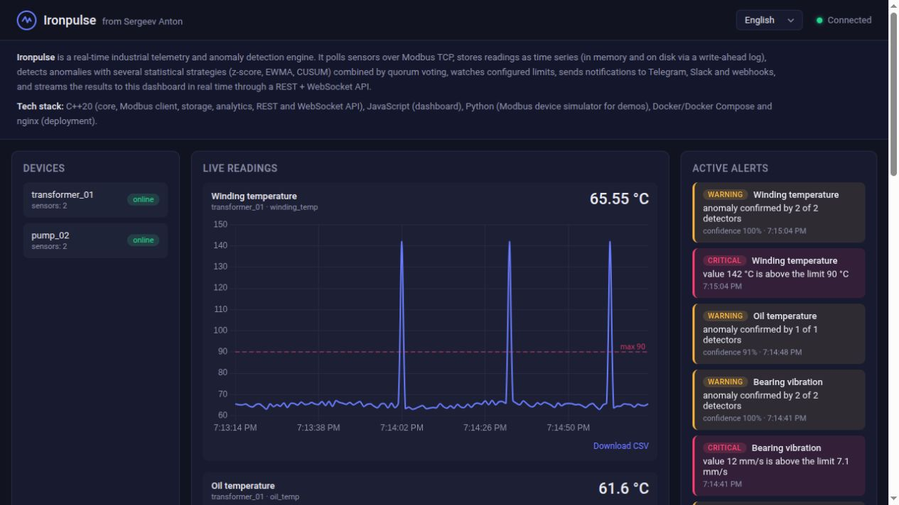

[English](README.md) · [Русский](README.ru.md) · [中文](README.zh.md) · [हिन्दी](README.hi.md) · [Español](README.es.md) · **العربية** · [Français](README.fr.md) · [Português](README.pt.md) · [Deutsch](README.de.md) · [日本語](README.ja.md) · [Italiano](README.it.md) · [Ελληνικά](README.el.md) · [Čeština](README.cs.md)

# أنطون سيرغييف
### مهندس ML/DL وC++/Python · الذكاء الاصطناعي الصناعي · أنظمة الطاقة والأتمتة

**أطوّر أنظمة تجمع بين التعلّم الآلي وC++ الحديث والهندسة الصناعية.** تشمل مشاريعي نماذج ML/DL والحوسبة الأصلية وخطوط بيانات القياس وأنظمة البحث، من معنى الإشارة إلى سلوك البرمجيات التي تعالجها.

أركّز على التحديات الهندسية الصعبة: البيانات المشوشة، والتعافي من الأعطال، والتزامن، وتقييم النماذج، والمفاضلات القابلة للقياس في الأداء.

## الأنظمة أثناء العمل

| ARGUS-NEURO | Ironpulse | Cognivore |
|---|---|---|
|  |  |  |
| نتائج تجربة ببيانات اصطناعية | محاكي Modbus ولوحة متابعة يعملان فعلياً | لقطة الواجهة من المستودع |

## مشاريع هندسية مختارة

### [ARGUS-NEURO](https://github.com/Anton-Sergeev-EA/ARGUS-NEURO) — التعلّم الآلي لتشخيص المعدات
استخراج خصائص الإشارات باستخدام C++20 وإتاحتها عبر pybind11، وكشف الشذوذ بالأساليب التقليدية، ونماذج PyTorch LSTM/GRU، والاستدلال باستخدام ONNX. توثّق أعمال الموثوقية تقسيم البيانات والنماذج المرجعية ومصدر البيانات وآلية الامتناع عن تقديم تقدير غير مدعوم بما يكفي.

**للفحص:** [عقد الموثوقية](https://github.com/Anton-Sergeev-EA/ARGUS-NEURO/blob/main/docs/RELIABILITY.md) · [مخرجات التجارب](https://github.com/Anton-Sergeev-EA/ARGUS-NEURO/tree/main/experiments) · [CI](https://github.com/Anton-Sergeev-EA/ARGUS-NEURO/actions).

### [Ironpulse](https://github.com/Anton-Sergeev-EA/Ironpulse) — قياس صناعي عن بُعد يتحمل الأعطال باستخدام C++20
جمع بيانات Modbus TCP بصورة غير متزامنة، ومهل زمنية وإعادة الاتصال، وتخزين WAL، وكشف إحصائي للشذوذ، وواجهات REST/WebSocket. يركّز المشروع على الحفاظ على سلوك مفيد عند فشل الاتصال أو التخزين.

**للفحص:** [الاختبارات](https://github.com/Anton-Sergeev-EA/Ironpulse/tree/main/tests) · [البناء وفحوص الذاكرة والتكامل عبر CI](https://github.com/Anton-Sergeev-EA/Ironpulse/actions).

### [Cognivore](https://github.com/Anton-Sergeev-EA/Cognivore) — البحث المحلي في المستندات وRAG
فهارس متجهات دقيقة وتقريبية مكتوبة بلغة C++ ومتكاملة مع Python، وتمثيلات embeddings، واسترجاع BM25 وواجهات API. تتيح اختبارات الفهارس وقياسات أحمال عمل محددة فحص سلوك البحث والمفاضلات المتعلقة بالأداء.

**للفحص:** [التنفيذ الأصلي](https://github.com/Anton-Sergeev-EA/Cognivore/tree/main/native) · [قياسات الأداء](https://github.com/Anton-Sergeev-EA/Cognivore/tree/main/benchmarks) · [CI](https://github.com/Anton-Sergeev-EA/Cognivore/actions).

### مشاريع أنظمة إضافية

- **[GridGuard](https://github.com/Anton-Sergeev-EA/GridGuard):** بيئة مختبرية لـIEC 61850 MMS/URCB، وجودة بيانات القياس، وWAL محمي بـCRC، وإعادة تسجيل البيانات في قواعد البيانات.
- **[SCADA Generator](https://github.com/Anton-Sergeev-EA/SCADA_Generator):** توليد HMI من الإعدادات، ومهايئات بروتوكولات صناعية، ودورة حياة الإنذارات، وتحليلات C++/Python.
- **[Adaptive capacity allocator](https://github.com/Anton-Sergeev-EA/adaptive_capacity_allocator):** سياسات نمو حاويات C++17/20 مع قياسات قابلة للتكرار للمفاضلة بين الذاكرة والزمن.

## نتائج مقاسة

تجارب محفوظة واختبارات أداء من المستودعات؛ الشروط والحدود موضحة في ملاحظات الأدلة.

| المشروع / المقياس | النتيجة | الشروط / المرجع / المصدر |
|---|---|---|
| ARGUS · RUL normalized MAE ↓ | **0.1875** vs **0.2880** | اختبار اصطناعي؛ المرجع وسيط هدف التدريب; [2026-09-30](https://github.com/Anton-Sergeev-EA/ARGUS-NEURO/blob/289671868e36cd1dee7a9ca55410851482e61e44/experiments/2026-09-30_reliability/metrics.json) |
| ARGUS · anomaly autoencoder | F1 **0.669** · recall **0.585** | 2,030 نافذة اختبار اصطناعية؛ فصل حسب المسارات; [metrics](https://github.com/Anton-Sergeev-EA/ARGUS-NEURO/blob/289671868e36cd1dee7a9ca55410851482e61e44/experiments/2026-09-30_reliability/metrics.json) |
| Cognivore · index build ↓ | C++ **0.027 s** vs NumPy **0.615 s** | 3,000 × 384 متجهات عشوائية؛ نواتان؛ حلقة NumPy `.add()`; [benchmark](https://github.com/Anton-Sergeev-EA/Cognivore/blob/8ca2aaad23280cf283731191be442c398f0f6ed1/README.md#benchmarks) |
| Cognivore · NSW Recall@10 / latency | **0.93 / 0.46 ms** | 3,000 متجه؛ ef=150؛ الاختبار نفسه; [method](https://github.com/Anton-Sergeev-EA/Cognivore/blob/8ca2aaad23280cf283731191be442c398f0f6ed1/benchmarks/bench_index.py) |

## البنية

ثلاثة مشاريع مستقلة؛ لا يمثل المخطط نشراً موحداً.

```mermaid
flowchart TB
  subgraph ARGUS[ARGUS-NEURO]
    A[Sensor windows] --> B[C++ features / pybind11]
    B --> C[ML / DL inference]
    C --> D[Evidence / abstention]
  end
  subgraph IRON[Ironpulse]
    E[Modbus TCP] --> F[Async polling / recovery]
    F --> G[Ring buffer / WAL]
    G --> H[Detection / REST / WebSocket]
  end
  subgraph COG[Cognivore]
    I[Documents] --> J[Chunks / embeddings / BM25]
    J --> K[C++ exact / NSW indexes]
    K --> L[Retrieval / grounded answers]
  end
```

## قرارات هندسية

- **ARGUS-NEURO:** فصل المسارات بين التدريب والتحقق والاختبار؛ ضبط المعالجة والعتبات دون استخدام بيانات الاختبار. [↗](https://github.com/Anton-Sergeev-EA/ARGUS-NEURO/blob/289671868e36cd1dee7a9ca55410851482e61e44/docs/RELIABILITY.md)
- **Ironpulse:** استخدام مخزن محدود للبيانات الحديثة واستعادة التاريخ عبر WAL؛ توضيح حدود متانة الكتابة على دفعات. [ADR ↗](https://github.com/Anton-Sergeev-EA/Ironpulse/blob/ff989c50f1e67ea7a65405904ab7dc73f6be6303/docs/adr/0002-storage-format.md)
- **Cognivore:** اختيار البحث الدقيق أو التقريبي وفق حجم المجموعة والزمن والاسترجاع؛ سرعة بناء الفهرس لا تثبت سرعة التطبيق كله. [↗](https://github.com/Anton-Sergeev-EA/Cognivore/blob/8ca2aaad23280cf283731191be442c398f0f6ed1/README.md#benchmarks)

## كيفية التحقق

[المصادر والإعدادات ونطاق القياس وأوامر التحقق](docs/EVIDENCE.md) · [ARGUS-NEURO](https://github.com/Anton-Sergeev-EA/ARGUS-NEURO/blob/289671868e36cd1dee7a9ca55410851482e61e44/README.md) · [Ironpulse](https://github.com/Anton-Sergeev-EA/Ironpulse/blob/ff989c50f1e67ea7a65405904ab7dc73f6be6303/README.md) · [Cognivore](https://github.com/Anton-Sergeev-EA/Cognivore/blob/8ca2aaad23280cf283731191be442c398f0f6ed1/README.md)

## الأدوات التقنية

| المجال | التقنيات والأساليب |
|---|---|
| التعلّم الآلي والتعلّم العميق | PyTorch، scikit-learn، LightGBM/XGBoost، LSTM/GRU، كشف الشذوذ، السلاسل الزمنية، PCA، ONNX |
| البرمجيات والبيانات | C++17/20، Python، CMake، pybind11، FastAPI، REST/WebSocket، PostgreSQL، SQLite |
| البحث والتسليم | RAG، embeddings، BM25، البحث المتجهي، Linux، Docker، GitHub Actions، pytest، CTest، Ruff، sanitizers |

## منهج العمل

أحوّل المتطلبات التشغيلية إلى عقود برمجية قابلة للاختبار، وأقيّم النماذج بالاستناد إلى البيانات والنماذج المرجعية، وأقيس الأداء قبل إطلاق الادعاءات.  تجارب ML على بيانات اصطناعية واختبارات البروتوكولات المختبرية تثبت نطاقها الموثّق، ولا تثبت الدقة الميدانية أو النشر أو الاعتماد. يوضح كل مستودع حدوده.

**التواصل:** [avsergeev1981@gmail.com](mailto:avsergeev1981@gmail.com) · [Apollonian](https://apollonian.ru/) · [جميع المستودعات](https://github.com/Anton-Sergeev-EA?tab=repositories).

