[English](README.md) · [Русский](README.ru.md) · [中文](README.zh.md) · [हिन्दी](README.hi.md) · [Español](README.es.md) · [العربية](README.ar.md) · [Français](README.fr.md) · [Português](README.pt.md) · [Deutsch](README.de.md) · [日本語](README.ja.md) · [Italiano](README.it.md) · [Ελληνικά](README.el.md) · **Čeština**

# Anton Sergeev
### ML/DL a C++/Python inženýr · Průmyslová AI · Energetika a automatizace

**Vyvíjím systémy na průsečíku strojového učení, moderního C++ a průmyslového inženýrství.** Mé projekty propojují modely ML/DL, nativní výpočty, telemetrii a vyhledávání—od významu signálu po chování softwaru, který jej zpracovává.

Zaměřuji se na náročné technické problémy: zašuměná data, obnovu po selhání, souběžnost, hodnocení modelů a měřitelné výkonnostní kompromisy.

## Systémy v provozu

| ARGUS-NEURO | Ironpulse | Cognivore |
|---|---|---|
|  |  |  |
| Výsledky syntetického experimentu | Běžící simulátor Modbus a dashboard | Snímek rozhraní z repozitáře |

## Vybrané technické projekty

### [ARGUS-NEURO](https://github.com/Anton-Sergeev-EA/ARGUS-NEURO) — strojové učení pro diagnostiku zařízení
Signálové příznaky v C++20 přes pybind11, klasická detekce anomálií, modely PyTorch LSTM/GRU a inference ONNX. Dokumentace popisuje rozdělení dat, referenční modely, původ dat a odmítnutí nedostatečně podloženého odhadu.

**K ověření:** [kontrakt spolehlivosti](https://github.com/Anton-Sergeev-EA/ARGUS-NEURO/blob/main/docs/RELIABILITY.md) · [artefakty experimentů](https://github.com/Anton-Sergeev-EA/ARGUS-NEURO/tree/main/experiments) · [CI](https://github.com/Anton-Sergeev-EA/ARGUS-NEURO/actions).

### [Ironpulse](https://github.com/Anton-Sergeev-EA/Ironpulse) — odolná průmyslová telemetrie v C++20
Asynchronní sběr Modbus TCP, časové limity a opětovné připojení, úložiště WAL, statistická detekce anomálií a rozhraní REST/WebSocket. Důraz je na chování při selhání komunikace a úložiště.

**K ověření:** [testy](https://github.com/Anton-Sergeev-EA/Ironpulse/tree/main/tests) · [sestavení, sanitizéry a integrace](https://github.com/Anton-Sergeev-EA/Ironpulse/actions).

### [Cognivore](https://github.com/Anton-Sergeev-EA/Cognivore) — lokální vyhledávání dokumentů a RAG
Přesné/přibližné vektorové indexy v C++ propojené s Pythonem, embeddings, BM25 a API. Testy indexů a benchmarky konkrétních zátěží umožňují ověřit chování vyhledávání a výkonnostní kompromisy.

**K ověření:** [nativní implementace](https://github.com/Anton-Sergeev-EA/Cognivore/tree/main/native) · [benchmarky](https://github.com/Anton-Sergeev-EA/Cognivore/tree/main/benchmarks) · [CI](https://github.com/Anton-Sergeev-EA/Cognivore/actions).

### Další systémy

- **[GridGuard](https://github.com/Anton-Sergeev-EA/GridGuard):** Laboratoř IEC 61850 MMS/URCB, kvalita telemetrie, WAL chráněný CRC a opakovaný zápis do databáze.
- **[SCADA_Generator](https://github.com/Anton-Sergeev-EA/SCADA_Generator):** HMI generované z konfigurace, adaptéry průmyslových protokolů, životní cyklus alarmů a analytika C++/Python.
- **[adaptive_capacity_allocator](https://github.com/Anton-Sergeev-EA/adaptive_capacity_allocator):** Strategie růstu kontejnerů C++17/20 s reprodukovatelným měřením paměti a času.

## Naměřené výsledky

Archivované experimenty a benchmarky repozitářů; podmínky a omezení jsou uvedeny v podkladech.

| Projekt / metrika | Výsledek | Podmínky / reference / zdroj |
|---|---|---|
| ARGUS · RUL normalized MAE ↓ | **0.1875** vs **0.2880** | Syntetický test; reference: medián trénovacího cíle; [2026-09-30](https://github.com/Anton-Sergeev-EA/ARGUS-NEURO/blob/289671868e36cd1dee7a9ca55410851482e61e44/experiments/2026-09-30_reliability/metrics.json) |
| ARGUS · anomaly autoencoder | F1 **0.669** · recall **0.585** | 2 030 syntetických testovacích oken; rozdělení podle trajektorií; [metrics](https://github.com/Anton-Sergeev-EA/ARGUS-NEURO/blob/289671868e36cd1dee7a9ca55410851482e61e44/experiments/2026-09-30_reliability/metrics.json) |
| Cognivore · index build ↓ | C++ **0.027 s** vs NumPy **0.615 s** | 3 000 × 384 náhodných vektorů; 2 jádra; smyčka NumPy `.add()`; [benchmark](https://github.com/Anton-Sergeev-EA/Cognivore/blob/8ca2aaad23280cf283731191be442c398f0f6ed1/README.md#benchmarks) |
| Cognivore · NSW Recall@10 / latency | **0.93 / 0.46 ms** | 3 000 vektorů; ef=150; stejný benchmark; [method](https://github.com/Anton-Sergeev-EA/Cognivore/blob/8ca2aaad23280cf283731191be442c398f0f6ed1/benchmarks/bench_index.py) |

## Architektura

Tři nezávislé projekty; diagram nepředstavuje společné nasazení.

```mermaid
flowchart TB
  subgraph ARGUS[ARGUS-NEURO]
    A[Sensor windows] --> B[C++ features / pybind11]
    B --> C[ML / DL inference]
    C --> D[Evidence / abstention]
  end
  subgraph IRON[Ironpulse]
    E[Modbus TCP] --> F[Async polling / recovery]
    F --> G[Ring buffer / WAL]
    G --> H[Detection / REST / WebSocket]
  end
  subgraph COG[Cognivore]
    I[Documents] --> J[Chunks / embeddings / BM25]
    J --> K[C++ exact / NSW indexes]
    K --> L[Retrieval / grounded answers]
  end
```

## Technická rozhodnutí

- **ARGUS-NEURO:** Oddělit trajektorie pro trénování, validaci a testování; předzpracování a prahy nastavit bez testovacích dat. [↗](https://github.com/Anton-Sergeev-EA/ARGUS-NEURO/blob/289671868e36cd1dee7a9ca55410851482e61e44/docs/RELIABILITY.md)
- **Ironpulse:** Použít omezený buffer a obnovu z WAL; popsat omezení trvanlivosti dávkových zápisů. [ADR ↗](https://github.com/Anton-Sergeev-EA/Ironpulse/blob/ff989c50f1e67ea7a65405904ab7dc73f6be6303/docs/adr/0002-storage-format.md)
- **Cognivore:** Volit přesné či přibližné vyhledávání podle velikosti, latence a recall; rychlejší tvorba indexu nedokazuje rychlost celé aplikace. [↗](https://github.com/Anton-Sergeev-EA/Cognivore/blob/8ca2aaad23280cf283731191be442c398f0f6ed1/README.md#benchmarks)

## Jak ověřit

[Zdroje, konfigurace, rozsah měření a ověřovací příkazy](docs/EVIDENCE.md) · [ARGUS-NEURO](https://github.com/Anton-Sergeev-EA/ARGUS-NEURO/blob/289671868e36cd1dee7a9ca55410851482e61e44/README.md) · [Ironpulse](https://github.com/Anton-Sergeev-EA/Ironpulse/blob/ff989c50f1e67ea7a65405904ab7dc73f6be6303/README.md) · [Cognivore](https://github.com/Anton-Sergeev-EA/Cognivore/blob/8ca2aaad23280cf283731191be442c398f0f6ed1/README.md)

## Technické nástroje

| Oblast | Technologie a metody |
|---|---|
| Strojové a hluboké učení | PyTorch, scikit-learn, LightGBM/XGBoost, LSTM/GRU, anomálie, časové řady, PCA, ONNX |
| Software a data | C++17/20, Python, CMake, pybind11, FastAPI, REST/WebSocket, PostgreSQL, SQLite |
| Vyhledávání a dodávání softwaru | RAG, embeddings, BM25, vektorové vyhledávání, Linux, Docker, GitHub Actions, pytest, CTest, Ruff, sanitizers |

## Technický přístup

Převádím provozní požadavky na testovatelné softwarové kontrakty, hodnotím modely vůči datům a referenčním řešením a měřím výkon před tvrzením o zrychlení. Syntetické ML experimenty a laboratorní protokolové testy dokládají svůj popsaný rozsah, nikoli přesnost v provozu, nasazení nebo certifikaci. Každý repozitář uvádí své limity.

**Kontakt:** [avsergeev1981@gmail.com](mailto:avsergeev1981@gmail.com) · [Apollonian](https://apollonian.ru/) · [všechny repozitáře](https://github.com/Anton-Sergeev-EA/?tab=repositories).

