[English](README.md) · [Русский](README.ru.md) · [中文](README.zh.md) · [हिन्दी](README.hi.md) · [Español](README.es.md) · [العربية](README.ar.md) · [Français](README.fr.md) · [Português](README.pt.md) · **Deutsch** · [日本語](README.ja.md) · [Italiano](README.it.md) · [Ελληνικά](README.el.md) · [Čeština](README.cs.md)

# Anton Sergeev
### ML/DL- und C++/Python-Engineer · Industrielle KI · Energietechnik und Automatisierung

**Ich entwickle Systeme an der Schnittstelle von maschinellem Lernen, modernem C++ und industrieller Technik.** Meine Projekte verbinden ML/DL-Modelle, native Rechenmodule, Telemetrie und Suchsysteme—von der Bedeutung eines Signals bis zum Verhalten der verarbeitenden Software.

Mein Fokus liegt auf anspruchsvollen Aufgaben: verrauschten Daten, Fehlerbehebung, Nebenläufigkeit, Modellevaluation und messbaren Leistungskompromissen.

## Systeme in Aktion

| ARGUS-NEURO | Ironpulse | Cognivore |
|---|---|---|
|  |  |  |
| Ergebnisse eines synthetischen Experiments | Laufender Modbus-Simulator mit Dashboard | Oberflächenaufnahme aus dem Repository |

## Ausgewählte Projekte

### [ARGUS-NEURO](https://github.com/Anton-Sergeev-EA/ARGUS-NEURO) — maschinelles Lernen für die Anlagendiagnose
Signalmerkmale aus C++20 über pybind11, klassische Anomalieerkennung, PyTorch-LSTM/GRU und ONNX-Inferenz. Dokumentiert sind Datenaufteilungen, Baselines, Datenherkunft und das Zurückhalten nicht ausreichend belegter Schätzungen.

**Einsehen:** [Zuverlässigkeitsvertrag](https://github.com/Anton-Sergeev-EA/ARGUS-NEURO/blob/main/docs/RELIABILITY.md) · [Experimentartefakte](https://github.com/Anton-Sergeev-EA/ARGUS-NEURO/tree/main/experiments) · [CI](https://github.com/Anton-Sergeev-EA/ARGUS-NEURO/actions).

### [Ironpulse](https://github.com/Anton-Sergeev-EA/Ironpulse) — robuste industrielle Telemetrie in C++20
Asynchrone Modbus-TCP-Erfassung, Timeouts und Wiederverbindung, WAL-Speicherung, statistische Anomalieerkennung und REST/WebSocket-Schnittstellen. Im Mittelpunkt steht sinnvolles Systemverhalten bei Kommunikations- und Speicherfehlern.

**Einsehen:** [Tests](https://github.com/Anton-Sergeev-EA/Ironpulse/tree/main/tests) · [Build-, Sanitizer- und Integrations-CI](https://github.com/Anton-Sergeev-EA/Ironpulse/actions).

### [Cognivore](https://github.com/Anton-Sergeev-EA/Cognivore) — lokale Dokumentensuche und RAG
Native C++-Indizes für exakte/approximative Vektorsuche mit Python-Anbindung, Embeddings, BM25 und APIs. Indextests und Benchmarks für konkrete Lastprofile machen Suchverhalten und Leistungskompromisse nachvollziehbar.

**Einsehen:** [native Implementierung](https://github.com/Anton-Sergeev-EA/Cognivore/tree/main/native) · [Benchmarks](https://github.com/Anton-Sergeev-EA/Cognivore/tree/main/benchmarks) · [CI](https://github.com/Anton-Sergeev-EA/Cognivore/actions).

### Weitere Systemprojekte

- **[GridGuard](https://github.com/Anton-Sergeev-EA/GridGuard):** IEC-61850-MMS/URCB-Labor, Telemetriequalität, CRC-geschütztes WAL und Datenbank-Replay.
- **[SCADA Generator](https://github.com/Anton-Sergeev-EA/SCADA_Generator):** HMI aus Konfiguration, industrielle Protokolladapter, Alarmlebenszyklus und C++/Python-Analytik.
- **[Adaptive capacity allocator](https://github.com/Anton-Sergeev-EA/adaptive_capacity_allocator):** C++17/20-Container-Wachstumsstrategien mit reproduzierbaren Speicher-/Zeitmessungen.

## Gemessene Ergebnisse

Archivierte Experimente und Repository-Benchmarks; Bedingungen und Grenzen stehen in den Nachweisen.

| Projekt / Messgröße | Ergebnis | Bedingungen / Referenz / Quelle |
|---|---|---|
| ARGUS · RUL normalized MAE ↓ | **0.1875** vs **0.2880** | Synthetischer Test; Referenz: Median des Trainingsziels; [2026-09-30](https://github.com/Anton-Sergeev-EA/ARGUS-NEURO/blob/289671868e36cd1dee7a9ca55410851482e61e44/experiments/2026-09-30_reliability/metrics.json) |
| ARGUS · anomaly autoencoder | F1 **0.669** · recall **0.585** | 2.030 synthetische Testfenster; Trennung nach Verläufen; [metrics](https://github.com/Anton-Sergeev-EA/ARGUS-NEURO/blob/289671868e36cd1dee7a9ca55410851482e61e44/experiments/2026-09-30_reliability/metrics.json) |
| Cognivore · index build ↓ | C++ **0.027 s** vs NumPy **0.615 s** | 3.000 × 384 Zufallsvektoren; 2 Kerne; NumPy `.add()`-Schleife; [benchmark](https://github.com/Anton-Sergeev-EA/Cognivore/blob/8ca2aaad23280cf283731191be442c398f0f6ed1/README.md#benchmarks) |
| Cognivore · NSW Recall@10 / latency | **0.93 / 0.46 ms** | 3.000 Vektoren; ef=150; gleicher Benchmark; [method](https://github.com/Anton-Sergeev-EA/Cognivore/blob/8ca2aaad23280cf283731191be442c398f0f6ed1/benchmarks/bench_index.py) |

## Architektur

Drei unabhängige Projekte; das Diagramm zeigt keine gemeinsame Bereitstellung.

```mermaid
flowchart TB
  subgraph ARGUS[ARGUS-NEURO]
    A[Sensor windows] --> B[C++ features / pybind11]
    B --> C[ML / DL inference]
    C --> D[Evidence / abstention]
  end
  subgraph IRON[Ironpulse]
    E[Modbus TCP] --> F[Async polling / recovery]
    F --> G[Ring buffer / WAL]
    G --> H[Detection / REST / WebSocket]
  end
  subgraph COG[Cognivore]
    I[Documents] --> J[Chunks / embeddings / BM25]
    J --> K[C++ exact / NSW indexes]
    K --> L[Retrieval / grounded answers]
  end
```

## Technische Entscheidungen

- **ARGUS-NEURO:** Trainings-, Validierungs- und Testverläufe trennen; Vorverarbeitung und Schwellenwerte ohne Testdaten anpassen. [↗](https://github.com/Anton-Sergeev-EA/ARGUS-NEURO/blob/289671868e36cd1dee7a9ca55410851482e61e44/docs/RELIABILITY.md)
- **Ironpulse:** Begrenzten Puffer und WAL-Wiederherstellung verwenden; Haltbarkeitsgrenzen gebündelter Schreibvorgänge dokumentieren. [ADR ↗](https://github.com/Anton-Sergeev-EA/Ironpulse/blob/ff989c50f1e67ea7a65405904ab7dc73f6be6303/docs/adr/0002-storage-format.md)
- **Cognivore:** Exakte oder approximative Suche nach Datenmenge, Latenz und Recall wählen; schnellerer Indexaufbau belegt keine höhere Gesamtgeschwindigkeit. [↗](https://github.com/Anton-Sergeev-EA/Cognivore/blob/8ca2aaad23280cf283731191be442c398f0f6ed1/README.md#benchmarks)

## Arbeit überprüfen

[Quellen, Konfiguration, Messumfang und Prüfbefehle](docs/EVIDENCE.md) · [ARGUS-NEURO](https://github.com/Anton-Sergeev-EA/ARGUS-NEURO/blob/289671868e36cd1dee7a9ca55410851482e61e44/README.md) · [Ironpulse](https://github.com/Anton-Sergeev-EA/Ironpulse/blob/ff989c50f1e67ea7a65405904ab7dc73f6be6303/README.md) · [Cognivore](https://github.com/Anton-Sergeev-EA/Cognivore/blob/8ca2aaad23280cf283731191be442c398f0f6ed1/README.md)

## Technische Werkzeuge

| Bereich | Technologien und Methoden |
|---|---|
| Machine Learning und Deep Learning | PyTorch, scikit-learn, LightGBM/XGBoost, LSTM/GRU, Anomalien, Zeitreihen, PCA, ONNX |
| Software und Daten | C++17/20, Python, CMake, pybind11, FastAPI, REST/WebSocket, PostgreSQL, SQLite |
| Suche und Bereitstellung | RAG, Embeddings, BM25, Vektorsuche, Linux, Docker, GitHub Actions, pytest, CTest, Ruff, Sanitizer |

## Arbeitsweise

Ich übersetze betriebliche Anforderungen in testbare Softwareverträge, bewerte Modelle anhand von Daten und Baselines und messe Leistung vor Leistungsversprechen.  synthetische ML-Experimente und Protokolltests im Labor belegen ihren dokumentierten Umfang, keine Feldgenauigkeit, Inbetriebnahme oder Zertifizierung. Jedes Repository beschreibt seine Grenzen.

**Kontakt:** [avsergeev1981@gmail.com](mailto:avsergeev1981@gmail.com) · [Apollonian](https://apollonian.ru/) · [alle Repositories](https://github.com/Anton-Sergeev-EA?tab=repositories).

