[English](README.md) · [Русский](README.ru.md) · [中文](README.zh.md) · [हिन्दी](README.hi.md) · [Español](README.es.md) · [العربية](README.ar.md) · [Français](README.fr.md) · [Português](README.pt.md) · [Deutsch](README.de.md) · [日本語](README.ja.md) · [Italiano](README.it.md) · **Ελληνικά** · [Čeština](README.cs.md)

# Άντον Σεργκέεφ
### Μηχανικός ML/DL και C++/Python · Βιομηχανική AI · Ενέργεια και αυτοματισμός

**Αναπτύσσω συστήματα στη διασταύρωση της μηχανικής μάθησης, της σύγχρονης C++ και της βιομηχανικής μηχανικής.** Τα έργα μου συνδυάζουν μοντέλα ML/DL, εγγενείς υπολογισμούς, τηλεμετρία και συστήματα αναζήτησης—από τη σημασία ενός σήματος μέχρι τη συμπεριφορά του λογισμικού που το επεξεργάζεται.

Εστιάζω στις δύσκολες τεχνικές προκλήσεις: θορυβώδη δεδομένα, ανάκαμψη από αστοχίες, ταυτόχρονη εκτέλεση, αξιολόγηση μοντέλων και μετρήσιμους συμβιβασμούς απόδοσης.

## Συστήματα σε λειτουργία

| ARGUS-NEURO | Ironpulse | Cognivore |
|---|---|---|
|  |  |  |
| Αποτελέσματα συνθετικού πειράματος | Προσομοιωτής Modbus και πίνακας σε λειτουργία | Στιγμιότυπο διεπαφής από το αποθετήριο |

## Επιλεγμένα τεχνικά έργα

### [ARGUS-NEURO](https://github.com/Anton-Sergeev-EA/ARGUS-NEURO) — μηχανική μάθηση για διάγνωση εξοπλισμού
Χαρακτηριστικά σημάτων σε C++20 μέσω pybind11, κλασική ανίχνευση ανωμαλιών, μοντέλα PyTorch LSTM/GRU και συμπερασμός ONNX. Τεκμηριώνονται οι διαχωρισμοί δεδομένων, τα μοντέλα αναφοράς, η προέλευση δεδομένων και η αποχή από ανεπαρκώς τεκμηριωμένες εκτιμήσεις.

**Για έλεγχο:** [σύμβαση αξιοπιστίας](https://github.com/Anton-Sergeev-EA/ARGUS-NEURO/blob/main/docs/RELIABILITY.md) · [αρχεία πειραμάτων](https://github.com/Anton-Sergeev-EA/ARGUS-NEURO/tree/main/experiments) · [CI](https://github.com/Anton-Sergeev-EA/ARGUS-NEURO/actions).

### [Ironpulse](https://github.com/Anton-Sergeev-EA/Ironpulse) — ανθεκτική βιομηχανική τηλεμετρία σε C++20
Ασύγχρονη συλλογή Modbus TCP, χρονικά όρια και επανασύνδεση, αποθήκευση WAL, στατιστική ανίχνευση ανωμαλιών και διεπαφές REST/WebSocket. Έμφαση στη συμπεριφορά κατά τις αστοχίες επικοινωνίας και αποθήκευσης.

**Για έλεγχο:** [δοκιμές](https://github.com/Anton-Sergeev-EA/Ironpulse/tree/main/tests) · [μεταγλώττιση, sanitizers και ολοκλήρωση](https://github.com/Anton-Sergeev-EA/Ironpulse/actions).

### [Cognivore](https://github.com/Anton-Sergeev-EA/Cognivore) — τοπική αναζήτηση εγγράφων και RAG
Ακριβή/προσεγγιστικά διανυσματικά ευρετήρια σε C++ με σύνδεση Python, embeddings, BM25 και API. Οι δοκιμές ευρετηρίων και οι μετρήσεις συγκεκριμένων φορτίων επιτρέπουν τον έλεγχο της αναζήτησης και των συμβιβασμών απόδοσης.

**Για έλεγχο:** [εγγενής υλοποίηση](https://github.com/Anton-Sergeev-EA/Cognivore/tree/main/native) · [μετρήσεις απόδοσης](https://github.com/Anton-Sergeev-EA/Cognivore/tree/main/benchmarks) · [CI](https://github.com/Anton-Sergeev-EA/Cognivore/actions).

### Πρόσθετα συστήματα

- **[GridGuard](https://github.com/Anton-Sergeev-EA/GridGuard):** Εργαστήριο IEC 61850 MMS/URCB, ποιότητα τηλεμετρίας, WAL με προστασία CRC και επανεγγραφή στη βάση δεδομένων.
- **[SCADA_Generator](https://github.com/Anton-Sergeev-EA/SCADA_Generator):** HMI από παραμετροποίηση, προσαρμογείς βιομηχανικών πρωτοκόλλων, κύκλος ζωής συναγερμών και ανάλυση C++/Python.
- **[adaptive_capacity_allocator](https://github.com/Anton-Sergeev-EA/adaptive_capacity_allocator):** Πολιτικές αύξησης χωρητικότητας περιεκτών C++17/20 με αναπαραγώγιμες μετρήσεις μνήμης και χρόνου.

## Μετρημένα αποτελέσματα

Αποθηκευμένα πειράματα και μετρήσεις των αποθετηρίων· οι συνθήκες και οι περιορισμοί τεκμηριώνονται στις σημειώσεις.

| Έργο / μέτρηση | Αποτέλεσμα | Συνθήκες / αναφορά / πηγή |
|---|---|---|
| ARGUS · RUL normalized MAE ↓ | **0.1875** vs **0.2880** | Συνθετικός έλεγχος· αναφορά: διάμεσος στόχου εκπαίδευσης; [2026-09-30](https://github.com/Anton-Sergeev-EA/ARGUS-NEURO/blob/289671868e36cd1dee7a9ca55410851482e61e44/experiments/2026-09-30_reliability/metrics.json) |
| ARGUS · anomaly autoencoder | F1 **0.669** · recall **0.585** | 2.030 συνθετικά παράθυρα ελέγχου· διαχωρισμός τροχιών; [metrics](https://github.com/Anton-Sergeev-EA/ARGUS-NEURO/blob/289671868e36cd1dee7a9ca55410851482e61e44/experiments/2026-09-30_reliability/metrics.json) |
| Cognivore · index build ↓ | C++ **0.027 s** vs NumPy **0.615 s** | 3.000 × 384 τυχαία διανύσματα· 2 πυρήνες· βρόχος NumPy `.add()`; [benchmark](https://github.com/Anton-Sergeev-EA/Cognivore/blob/8ca2aaad23280cf283731191be442c398f0f6ed1/README.md#benchmarks) |
| Cognivore · NSW Recall@10 / latency | **0.93 / 0.46 ms** | 3.000 διανύσματα· ef=150· ίδια μέτρηση; [method](https://github.com/Anton-Sergeev-EA/Cognivore/blob/8ca2aaad23280cf283731191be442c398f0f6ed1/benchmarks/bench_index.py) |

## Αρχιτεκτονική

Τρία ανεξάρτητα έργα· το διάγραμμα δεν υποδηλώνει ενιαία εγκατάσταση.

```mermaid
flowchart TB
  subgraph ARGUS[ARGUS-NEURO]
    A[Sensor windows] --> B[C++ features / pybind11]
    B --> C[ML / DL inference]
    C --> D[Evidence / abstention]
  end
  subgraph IRON[Ironpulse]
    E[Modbus TCP] --> F[Async polling / recovery]
    F --> G[Ring buffer / WAL]
    G --> H[Detection / REST / WebSocket]
  end
  subgraph COG[Cognivore]
    I[Documents] --> J[Chunks / embeddings / BM25]
    J --> K[C++ exact / NSW indexes]
    K --> L[Retrieval / grounded answers]
  end
```

## Τεχνικές αποφάσεις

- **ARGUS-NEURO:** Διαχωρισμός τροχιών εκπαίδευσης, επικύρωσης και ελέγχου· προσαρμογή προεπεξεργασίας και ορίων χωρίς δεδομένα ελέγχου. [↗](https://github.com/Anton-Sergeev-EA/ARGUS-NEURO/blob/289671868e36cd1dee7a9ca55410851482e61e44/docs/RELIABILITY.md)
- **Ironpulse:** Περιορισμένος προσωρινός χώρος και ανάκτηση μέσω WAL· τεκμηρίωση των ορίων ανθεκτικότητας των ομαδικών εγγραφών. [ADR ↗](https://github.com/Anton-Sergeev-EA/Ironpulse/blob/ff989c50f1e67ea7a65405904ab7dc73f6be6303/docs/adr/0002-storage-format.md)
- **Cognivore:** Επιλογή ακριβούς ή προσεγγιστικής αναζήτησης βάσει μεγέθους, καθυστέρησης και ανάκλησης· η ταχύτητα κατασκευής ευρετηρίου δεν αφορά ολόκληρη την εφαρμογή. [↗](https://github.com/Anton-Sergeev-EA/Cognivore/blob/8ca2aaad23280cf283731191be442c398f0f6ed1/README.md#benchmarks)

## Επαλήθευση

[Πηγές, ρυθμίσεις, πεδίο μετρήσεων και εντολές ελέγχου](docs/EVIDENCE.md) · [ARGUS-NEURO](https://github.com/Anton-Sergeev-EA/ARGUS-NEURO/blob/289671868e36cd1dee7a9ca55410851482e61e44/README.md) · [Ironpulse](https://github.com/Anton-Sergeev-EA/Ironpulse/blob/ff989c50f1e67ea7a65405904ab7dc73f6be6303/README.md) · [Cognivore](https://github.com/Anton-Sergeev-EA/Cognivore/blob/8ca2aaad23280cf283731191be442c398f0f6ed1/README.md)

## Τεχνικά εργαλεία

| Τομέας | Τεχνολογίες και μέθοδοι |
|---|---|
| Μηχανική και βαθιά μάθηση | PyTorch, scikit-learn, LightGBM/XGBoost, LSTM/GRU, ανωμαλίες, χρονοσειρές, PCA, ONNX |
| Λογισμικό και δεδομένα | C++17/20, Python, CMake, pybind11, FastAPI, REST/WebSocket, PostgreSQL, SQLite |
| Αναζήτηση και παράδοση | RAG, embeddings, BM25, διανυσματική αναζήτηση, Linux, Docker, GitHub Actions, pytest, CTest, Ruff, sanitizers |

## Τεχνική προσέγγιση

Μετατρέπω λειτουργικές απαιτήσεις σε ελέγξιμες συμβάσεις λογισμικού, αξιολογώ μοντέλα ως προς τα δεδομένα και τα μοντέλα αναφοράς και μετρώ πριν διατυπώσω ισχυρισμούς απόδοσης. Τα πειράματα ML με συνθετικά δεδομένα και οι εργαστηριακές δοκιμές πρωτοκόλλων τεκμηριώνουν το δηλωμένο εύρος τους, όχι ακρίβεια πεδίου, εγκατάσταση ή πιστοποίηση. Κάθε αποθετήριο περιγράφει τους περιορισμούς του.

**Επικοινωνία:** [avsergeev1981@gmail.com](mailto:avsergeev1981@gmail.com) · [Apollonian](https://apollonian.ru/) · [όλα τα αποθετήρια](https://github.com/Anton-Sergeev-EA/?tab=repositories).

