[English](README.md) · [Русский](README.ru.md) · [中文](README.zh.md) · [हिन्दी](README.hi.md) · **Español** · [العربية](README.ar.md) · [Français](README.fr.md) · [Português](README.pt.md) · [Deutsch](README.de.md) · [日本語](README.ja.md) · [Italiano](README.it.md) · [Ελληνικά](README.el.md) · [Čeština](README.cs.md)

# Anton Sergeev
### Ingeniero de ML/DL y C++/Python · IA industrial · Sistemas eléctricos y automatización

**Desarrollo sistemas en la intersección del aprendizaje automático, C++ moderno y la ingeniería industrial.** Mi trabajo abarca modelos ML/DL, módulos de cálculo nativos, telemetría y sistemas de búsqueda: desde el significado de una señal hasta el comportamiento del software que la procesa.

Me centro en los retos difíciles: datos ruidosos, recuperación ante fallos, concurrencia, evaluación de modelos y compromisos de rendimiento medibles.

## Sistemas en acción

| ARGUS-NEURO | Ironpulse | Cognivore |
|---|---|---|
|  |  |  |
| Resultados de un experimento sintético | Simulador Modbus y panel en funcionamiento | Captura de la interfaz del repositorio |

## Proyectos destacados

### [ARGUS-NEURO](https://github.com/Anton-Sergeev-EA/ARGUS-NEURO) — aprendizaje automático para diagnóstico de equipos
Características de señales en C++20 mediante pybind11, detección clásica de anomalías, modelos PyTorch LSTM/GRU e inferencia ONNX. Se documentan particiones de datos, baselines, procedencia y abstención: el sistema puede rechazar una estimación sin respaldo suficiente.

**Revisar:** [contrato de fiabilidad](https://github.com/Anton-Sergeev-EA/ARGUS-NEURO/blob/main/docs/RELIABILITY.md) · [artefactos experimentales](https://github.com/Anton-Sergeev-EA/ARGUS-NEURO/tree/main/experiments) · [CI](https://github.com/Anton-Sergeev-EA/ARGUS-NEURO/actions).

### [Ironpulse](https://github.com/Anton-Sergeev-EA/Ironpulse) — telemetría industrial resiliente en C++20
Adquisición asíncrona Modbus TCP, tiempos de espera y reconexión, almacenamiento WAL, detección estadística de anomalías e interfaces REST/WebSocket. El objetivo es mantener un comportamiento útil ante fallos de comunicación o almacenamiento.

**Revisar:** [pruebas](https://github.com/Anton-Sergeev-EA/Ironpulse/tree/main/tests) · [compilación, sanitizers e integración CI](https://github.com/Anton-Sergeev-EA/Ironpulse/actions).

### [Cognivore](https://github.com/Anton-Sergeev-EA/Cognivore) — búsqueda documental local y RAG
Índices vectoriales exactos/aproximados en C++ integrados con Python, embeddings, BM25 y API. Las pruebas de índices y benchmarks con cargas específicas permiten revisar el comportamiento y los compromisos de rendimiento.

**Revisar:** [implementación nativa](https://github.com/Anton-Sergeev-EA/Cognivore/tree/main/native) · [benchmarks](https://github.com/Anton-Sergeev-EA/Cognivore/tree/main/benchmarks) · [CI](https://github.com/Anton-Sergeev-EA/Cognivore/actions).

### Otros sistemas

- **[GridGuard](https://github.com/Anton-Sergeev-EA/GridGuard):** laboratorio IEC 61850 MMS/URCB, calidad de telemetría, WAL protegido por CRC y reproducción en bases de datos.
- **[SCADA Generator](https://github.com/Anton-Sergeev-EA/SCADA_Generator):** HMI generado desde configuración, adaptadores industriales, ciclo de alarmas y analítica C++/Python.
- **[Adaptive capacity allocator](https://github.com/Anton-Sergeev-EA/adaptive_capacity_allocator):** políticas de crecimiento de contenedores C++17/20 con mediciones reproducibles de memoria y tiempo.

## Resultadoados medidos

Experimentos guardados y benchmarks del repositorio; condiciones y límites en las notas de evidencia.

| Proyecto / métrica | Resultado | Condiciones / referencia / fuente |
|---|---|---|
| ARGUS · RUL normalized MAE ↓ | **0.1875** vs **0.2880** | Test sintético; referencia: mediana del objetivo de entrenamiento; [2026-09-30](https://github.com/Anton-Sergeev-EA/ARGUS-NEURO/blob/289671868e36cd1dee7a9ca55410851482e61e44/experiments/2026-09-30_reliability/metrics.json) |
| ARGUS · anomaly autoencoder | F1 **0.669** · recall **0.585** | 2.030 ventanas sintéticas de test; división por trayectorias; [metrics](https://github.com/Anton-Sergeev-EA/ARGUS-NEURO/blob/289671868e36cd1dee7a9ca55410851482e61e44/experiments/2026-09-30_reliability/metrics.json) |
| Cognivore · index build ↓ | C++ **0.027 s** vs NumPy **0.615 s** | 3.000 × 384 vectores aleatorios; 2 núcleos; bucle NumPy `.add()`; [benchmark](https://github.com/Anton-Sergeev-EA/Cognivore/blob/8ca2aaad23280cf283731191be442c398f0f6ed1/README.md#benchmarks) |
| Cognivore · NSW Recall@10 / latency | **0.93 / 0.46 ms** | 3.000 vectores; ef=150; mismo benchmark; [method](https://github.com/Anton-Sergeev-EA/Cognivore/blob/8ca2aaad23280cf283731191be442c398f0f6ed1/benchmarks/bench_index.py) |

## Arquitectura

Tres proyectos independientes; el diagrama no implica un despliegue integrado.

```mermaid
flowchart TB
  subgraph ARGUS[ARGUS-NEURO]
    A[Sensor windows] --> B[C++ features / pybind11]
    B --> C[ML / DL inference]
    C --> D[Evidence / abstention]
  end
  subgraph IRON[Ironpulse]
    E[Modbus TCP] --> F[Async polling / recovery]
    F --> G[Ring buffer / WAL]
    G --> H[Detection / REST / WebSocket]
  end
  subgraph COG[Cognivore]
    I[Documents] --> J[Chunks / embeddings / BM25]
    J --> K[C++ exact / NSW indexes]
    K --> L[Retrieval / grounded answers]
  end
```

## Decisiones de ingeniería

- **ARGUS-NEURO:** Separar trayectorias de entrenamiento, validación y prueba; ajustar preprocesamiento y umbrales sin datos de prueba. [↗](https://github.com/Anton-Sergeev-EA/ARGUS-NEURO/blob/289671868e36cd1dee7a9ca55410851482e61e44/docs/RELIABILITY.md)
- **Ironpulse:** Usar un búfer acotado y recuperación mediante WAL; explicitar los límites de durabilidad de las escrituras por lotes. [ADR ↗](https://github.com/Anton-Sergeev-EA/Ironpulse/blob/ff989c50f1e67ea7a65405904ab7dc73f6be6303/docs/adr/0002-storage-format.md)
- **Cognivore:** Elegir búsqueda exacta o aproximada según tamaño, latencia y recall; construir el índice más rápido no demuestra mayor velocidad de toda la aplicación. [↗](https://github.com/Anton-Sergeev-EA/Cognivore/blob/8ca2aaad23280cf283731191be442c398f0f6ed1/README.md#benchmarks)

## Cómo verificar

[Fuentes, configuración, alcance y comandos de verificación](docs/EVIDENCE.md) · [ARGUS-NEURO](https://github.com/Anton-Sergeev-EA/ARGUS-NEURO/blob/289671868e36cd1dee7a9ca55410851482e61e44/README.md) · [Ironpulse](https://github.com/Anton-Sergeev-EA/Ironpulse/blob/ff989c50f1e67ea7a65405904ab7dc73f6be6303/README.md) · [Cognivore](https://github.com/Anton-Sergeev-EA/Cognivore/blob/8ca2aaad23280cf283731191be442c398f0f6ed1/README.md)

## Herramientas técnicas

| Área | Tecnologías y métodos |
|---|---|
| Machine Learning y Deep Learning | PyTorch, scikit-learn, LightGBM/XGBoost, LSTM/GRU, anomalías, series temporales, PCA, ONNX |
| Software y datos | C++17/20, Python, CMake, pybind11, FastAPI, REST/WebSocket, PostgreSQL, SQLite |
| Búsqueda y entrega | RAG, embeddings, BM25, búsqueda vectorial, Linux, Docker, GitHub Actions, pytest, CTest, Ruff, sanitizers |

## Forma de trabajar

Convierto requisitos operativos en contratos de software verificables, evalúo modelos respecto a datos y baselines y mido antes de afirmar mejoras de rendimiento.  los experimentos sintéticos y las pruebas de laboratorio demuestran su alcance declarado, no precisión en campo, despliegue ni certificación. Cada repositorio documenta sus límites.

**Contacto:** [avsergeev1981@gmail.com](mailto:avsergeev1981@gmail.com) · [Apollonian](https://apollonian.ru/) · [todos los repositorios](https://github.com/Anton-Sergeev-EA?tab=repositories).

