[English](README.md) · [Русский](README.ru.md) · [中文](README.zh.md) · [हिन्दी](README.hi.md) · [Español](README.es.md) · [العربية](README.ar.md) · **Français** · [Português](README.pt.md) · [Deutsch](README.de.md) · [日本語](README.ja.md) · [Italiano](README.it.md) · [Ελληνικά](README.el.md) · [Čeština](README.cs.md)

# Anton Sergeev
### Ingénieur ML/DL et C++/Python · IA industrielle · Énergie et automatisation

**Je développe des systèmes à la croisée du machine learning, du C++ moderne et de l’ingénierie industrielle.** Mes projets associent modèles ML/DL, calcul natif, télémétrie et recherche documentaire, du sens d’un signal au comportement du logiciel qui le traite.

Je me concentre sur les difficultés techniques : données bruitées, reprise après incident, concurrence, évaluation des modèles et compromis de performance mesurables.

## Systèmes en action

| ARGUS-NEURO | Ironpulse | Cognivore |
|---|---|---|
|  |  |  |
| Résultats d’une expérience synthétique | Simulateur Modbus et tableau de bord en fonctionnement | Capture de l’interface du dépôt |

## Projets d’ingénierie

### [ARGUS-NEURO](https://github.com/Anton-Sergeev-EA/ARGUS-NEURO) — machine learning pour le diagnostic des équipements
Caractéristiques de signaux en C++20 via pybind11, détection classique d’anomalies, modèles PyTorch LSTM/GRU et inférence ONNX. Les partitions de données, baselines, provenance et mécanismes d’abstention sont documentés : le système peut refuser une estimation insuffisamment étayée.

**À examiner:** [contrat de fiabilité](https://github.com/Anton-Sergeev-EA/ARGUS-NEURO/blob/main/docs/RELIABILITY.md) · [artefacts expérimentaux](https://github.com/Anton-Sergeev-EA/ARGUS-NEURO/tree/main/experiments) · [CI](https://github.com/Anton-Sergeev-EA/ARGUS-NEURO/actions).

### [Ironpulse](https://github.com/Anton-Sergeev-EA/Ironpulse) — télémétrie industrielle robuste en C++20
Acquisition asynchrone Modbus TCP, délais d’attente et reconnexion, stockage WAL, détection statistique d’anomalies et interfaces REST/WebSocket. Le projet met l’accent sur le comportement en cas de panne des communications ou du stockage.

**À examiner:** [tests](https://github.com/Anton-Sergeev-EA/Ironpulse/tree/main/tests) · [compilation, sanitizers et intégration](https://github.com/Anton-Sergeev-EA/Ironpulse/actions).

### [Cognivore](https://github.com/Anton-Sergeev-EA/Cognivore) — recherche documentaire locale et RAG
Index vectoriels exacts/approximatifs en C++ intégrés à Python, embeddings, BM25 et API. Les tests d’index et benchmarks sur des charges précises rendent vérifiables le comportement de la recherche et les compromis de performance.

**À examiner:** [implémentation native](https://github.com/Anton-Sergeev-EA/Cognivore/tree/main/native) · [benchmarks](https://github.com/Anton-Sergeev-EA/Cognivore/tree/main/benchmarks) · [CI](https://github.com/Anton-Sergeev-EA/Cognivore/actions).

### Autres systèmes

- **[GridGuard](https://github.com/Anton-Sergeev-EA/GridGuard):** Laboratoire IEC 61850 MMS/URCB, qualité de télémétrie, WAL protégé par CRC et rejeu en base de données.
- **[SCADA_Generator](https://github.com/Anton-Sergeev-EA/SCADA_Generator):** HMI générée par configuration, adaptateurs de protocoles industriels, cycle de vie des alarmes et analyse C++/Python.
- **[adaptive_capacity_allocator](https://github.com/Anton-Sergeev-EA/adaptive_capacity_allocator):** Politiques de croissance de conteneurs C++17/20 avec mesures reproductibles de mémoire et de temps.

## Résultats mesurés

Expériences archivées et benchmarks des dépôts ; conditions et limites dans les notes de preuve.

| Projet / mesure | Résultat | Conditions / référence / source |
|---|---|---|
| ARGUS · RUL normalized MAE ↓ | **0.1875** vs **0.2880** | Test synthétique ; référence : médiane de la cible d’entraînement; [2026-09-30](https://github.com/Anton-Sergeev-EA/ARGUS-NEURO/blob/289671868e36cd1dee7a9ca55410851482e61e44/experiments/2026-09-30_reliability/metrics.json) |
| ARGUS · anomaly autoencoder | F1 **0.669** · recall **0.585** | 2 030 fenêtres synthétiques de test ; séparation par trajectoires; [metrics](https://github.com/Anton-Sergeev-EA/ARGUS-NEURO/blob/289671868e36cd1dee7a9ca55410851482e61e44/experiments/2026-09-30_reliability/metrics.json) |
| Cognivore · index build ↓ | C++ **0.027 s** vs NumPy **0.615 s** | 3 000 × 384 vecteurs aléatoires ; 2 cœurs ; boucle NumPy `.add()`; [benchmark](https://github.com/Anton-Sergeev-EA/Cognivore/blob/8ca2aaad23280cf283731191be442c398f0f6ed1/README.md#benchmarks) |
| Cognivore · NSW Recall@10 / latency | **0.93 / 0.46 ms** | 3 000 vecteurs ; ef=150 ; même benchmark; [method](https://github.com/Anton-Sergeev-EA/Cognivore/blob/8ca2aaad23280cf283731191be442c398f0f6ed1/benchmarks/bench_index.py) |

## Architecture

Trois projets indépendants ; le schéma ne représente pas un déploiement intégré.

```mermaid
flowchart TB
  subgraph ARGUS[ARGUS-NEURO]
    A[Sensor windows] --> B[C++ features / pybind11]
    B --> C[ML / DL inference]
    C --> D[Evidence / abstention]
  end
  subgraph IRON[Ironpulse]
    E[Modbus TCP] --> F[Async polling / recovery]
    F --> G[Ring buffer / WAL]
    G --> H[Detection / REST / WebSocket]
  end
  subgraph COG[Cognivore]
    I[Documents] --> J[Chunks / embeddings / BM25]
    J --> K[C++ exact / NSW indexes]
    K --> L[Retrieval / grounded answers]
  end
```

## Décisions techniques

- **ARGUS-NEURO:** Séparer les trajectoires d’entraînement, de validation et de test ; ajuster le prétraitement et les seuils sans données de test. [↗](https://github.com/Anton-Sergeev-EA/ARGUS-NEURO/blob/289671868e36cd1dee7a9ca55410851482e61e44/docs/RELIABILITY.md)
- **Ironpulse:** Utiliser un tampon borné et la reprise par WAL ; documenter les limites de durabilité des écritures groupées. [ADR ↗](https://github.com/Anton-Sergeev-EA/Ironpulse/blob/ff989c50f1e67ea7a65405904ab7dc73f6be6303/docs/adr/0002-storage-format.md)
- **Cognivore:** Choisir la recherche exacte ou approximative selon le volume, la latence et le rappel ; la vitesse de construction de l’index ne mesure pas celle de toute l’application. [↗](https://github.com/Anton-Sergeev-EA/Cognivore/blob/8ca2aaad23280cf283731191be442c398f0f6ed1/README.md#benchmarks)

## Vérifier le travail

[Sources, configuration, portée des mesures et commandes de vérification](docs/EVIDENCE.md) · [ARGUS-NEURO](https://github.com/Anton-Sergeev-EA/ARGUS-NEURO/blob/289671868e36cd1dee7a9ca55410851482e61e44/README.md) · [Ironpulse](https://github.com/Anton-Sergeev-EA/Ironpulse/blob/ff989c50f1e67ea7a65405904ab7dc73f6be6303/README.md) · [Cognivore](https://github.com/Anton-Sergeev-EA/Cognivore/blob/8ca2aaad23280cf283731191be442c398f0f6ed1/README.md)

## Outils techniques

| Domaine | Technologies et méthodes |
|---|---|
| Machine Learning et Deep Learning | PyTorch, scikit-learn, LightGBM/XGBoost, LSTM/GRU, anomalies, séries temporelles, PCA, ONNX |
| Logiciels et données | C++17/20, Python, CMake, pybind11, FastAPI, REST/WebSocket, PostgreSQL, SQLite |
| Recherche et livraison | RAG, embeddings, BM25, recherche vectorielle, Linux, Docker, GitHub Actions, pytest, CTest, Ruff, sanitizers |

## Approche d’ingénierie

Je transforme les exigences opérationnelles en contrats logiciels testables, évalue les modèles par rapport aux données et aux baselines, et mesure avant d’annoncer un gain de performance. Les expériences ML synthétiques et les tests de protocoles en laboratoire démontrent leur périmètre documenté, pas la précision sur le terrain, un déploiement ou une certification. Chaque dépôt décrit ses limites.

**Contact:** [avsergeev1981@gmail.com](mailto:avsergeev1981@gmail.com) · [Apollonian](https://apollonian.ru/) · [tous les dépôts](https://github.com/Anton-Sergeev-EA/?tab=repositories).

