[English](README.md) · [Русский](README.ru.md) · [中文](README.zh.md) · **हिन्दी** · [Español](README.es.md) · [العربية](README.ar.md) · [Français](README.fr.md) · [Português](README.pt.md) · [Deutsch](README.de.md) · [日本語](README.ja.md) · [Italiano](README.it.md) · [Ελληνικά](README.el.md) · [Čeština](README.cs.md)

# अंतोन सर्गेयेव
### ML/DL और C++/Python इंजीनियर · औद्योगिक AI · विद्युत प्रणालियाँ और स्वचालन

**मैं मशीन लर्निंग, आधुनिक C++ और औद्योगिक इंजीनियरिंग के संगम पर सिस्टम विकसित करता हूँ।** मेरे काम में ML/DL मॉडल, नेटिव गणना, टेलीमेट्री पाइपलाइन और खोज प्रणालियाँ शामिल हैं—सिग्नल के अर्थ से लेकर उसे संसाधित करने वाले सॉफ्टवेयर के व्यवहार तक।

मेरा ध्यान कठिन इंजीनियरिंग समस्याओं पर है: शोरयुक्त डेटा, विफलता से पुनर्प्राप्ति, समवर्ती निष्पादन, मॉडल मूल्यांकन और मापने योग्य प्रदर्शन समझौते।

## सिस्टम प्रदर्शन

| ARGUS-NEURO | Ironpulse | Cognivore |
|---|---|---|
|  |  |  |
| सिंथेटिक प्रयोग के परिणाम | चलता हुआ Modbus सिम्युलेटर और डैशबोर्ड | रिपॉज़िटरी से इंटरफ़ेस का चित्र |

## चुनिंदा इंजीनियरिंग परियोजनाएँ

### [ARGUS-NEURO](https://github.com/Anton-Sergeev-EA/ARGUS-NEURO) — उपकरण निदान के लिए मशीन लर्निंग
pybind11 के माध्यम से C++20 सिग्नल फीचर, पारंपरिक विसंगति पहचान, PyTorch LSTM/GRU और ONNX इन्फरेंस। डेटा विभाजन, बेसलाइन, डेटा का स्रोत और पर्याप्त प्रमाण न होने पर अनुमान देने से इनकार करने की व्यवस्था दस्तावेज़ों में स्पष्ट हैं।

**देखें:** [विश्वसनीयता अनुबंध](https://github.com/Anton-Sergeev-EA/ARGUS-NEURO/blob/main/docs/RELIABILITY.md) · [प्रयोग के परिणाम और विन्यास](https://github.com/Anton-Sergeev-EA/ARGUS-NEURO/tree/main/experiments) · [CI](https://github.com/Anton-Sergeev-EA/ARGUS-NEURO/actions)।

### [Ironpulse](https://github.com/Anton-Sergeev-EA/Ironpulse) — C++20 में विश्वसनीय औद्योगिक टेलीमेट्री
असिंक्रोनस Modbus TCP संग्रह, टाइमआउट और पुनः कनेक्शन, WAL स्टोरेज, सांख्यिकीय विसंगति पहचान तथा REST/WebSocket इंटरफेस। संचार या स्टोरेज विफल होने पर उपयोगी व्यवहार बनाए रखना इसका मुख्य लक्ष्य है।

**देखें:** [परीक्षण](https://github.com/Anton-Sergeev-EA/Ironpulse/tree/main/tests) · [बिल्ड, सैनिटाइज़र और एकीकरण CI](https://github.com/Anton-Sergeev-EA/Ironpulse/actions)।

### [Cognivore](https://github.com/Anton-Sergeev-EA/Cognivore) — स्थानीय दस्तावेज़ खोज और RAG
Python से जुड़े C++ सटीक/अनुमानित वेक्टर इंडेक्स, embeddings, BM25 और API। इंडेक्स परीक्षण तथा विशिष्ट वर्कलोड के बेंचमार्क खोज व्यवहार और प्रदर्शन के समझौतों को स्पष्ट करते हैं।

**देखें:** [नेटिव कार्यान्वयन](https://github.com/Anton-Sergeev-EA/Cognivore/tree/main/native) · [बेंचमार्क](https://github.com/Anton-Sergeev-EA/Cognivore/tree/main/benchmarks) · [CI](https://github.com/Anton-Sergeev-EA/Cognivore/actions)।

### अन्य सिस्टम परियोजनाएँ

- **[GridGuard](https://github.com/Anton-Sergeev-EA/GridGuard):** IEC 61850 MMS/URCB प्रयोगशाला, टेलीमेट्री गुणवत्ता, CRC-सुरक्षित WAL और डेटाबेस रीप्ले।
- **[SCADA Generator](https://github.com/Anton-Sergeev-EA/SCADA_Generator):** कॉन्फ़िगरेशन से HMI, औद्योगिक प्रोटोकॉल एडाप्टर, अलार्म जीवनचक्र और C++/Python विश्लेषण।
- **[Adaptive capacity allocator](https://github.com/Anton-Sergeev-EA/adaptive_capacity_allocator):** C++17/20 कंटेनर वृद्धि नीतियाँ और दोहराए जा सकने वाले मेमोरी/समय माप।

## मापे गए परिणाम

सहेजे गए प्रयोग और रिपॉज़िटरी बेंचमार्क; परिस्थितियाँ और सीमाएँ साक्ष्य विवरण में हैं।

| परियोजना / मेट्रिक | परिणाम | परिस्थितियाँ / बेसलाइन / स्रोत |
|---|---|---|
| ARGUS · RUL normalized MAE ↓ | **0.1875** vs **0.2880** | सिंथेटिक परीक्षण; प्रशिक्षण लक्ष्य का मध्यक बेसलाइन; [2026-09-30](https://github.com/Anton-Sergeev-EA/ARGUS-NEURO/blob/289671868e36cd1dee7a9ca55410851482e61e44/experiments/2026-09-30_reliability/metrics.json) |
| ARGUS · anomaly autoencoder | F1 **0.669** · recall **0.585** | 2,030 सिंथेटिक परीक्षण विंडो; समय-श्रृंखला के आधार पर विभाजन; [metrics](https://github.com/Anton-Sergeev-EA/ARGUS-NEURO/blob/289671868e36cd1dee7a9ca55410851482e61e44/experiments/2026-09-30_reliability/metrics.json) |
| Cognivore · index build ↓ | C++ **0.027 s** vs NumPy **0.615 s** | 3,000 × 384 यादृच्छिक वेक्टर; 2 कोर; NumPy `.add()` लूप; [benchmark](https://github.com/Anton-Sergeev-EA/Cognivore/blob/8ca2aaad23280cf283731191be442c398f0f6ed1/README.md#benchmarks) |
| Cognivore · NSW Recall@10 / latency | **0.93 / 0.46 ms** | 3,000 वेक्टर; ef=150; वही बेंचमार्क; [method](https://github.com/Anton-Sergeev-EA/Cognivore/blob/8ca2aaad23280cf283731191be442c398f0f6ed1/benchmarks/bench_index.py) |

## आर्किटेक्चर

तीन स्वतंत्र परियोजनाओं के प्रवाह; यह चित्र संयुक्त तैनाती का दावा नहीं है।

```mermaid
flowchart TB
  subgraph ARGUS[ARGUS-NEURO]
    A[Sensor windows] --> B[C++ features / pybind11]
    B --> C[ML / DL inference]
    C --> D[Evidence / abstention]
  end
  subgraph IRON[Ironpulse]
    E[Modbus TCP] --> F[Async polling / recovery]
    F --> G[Ring buffer / WAL]
    G --> H[Detection / REST / WebSocket]
  end
  subgraph COG[Cognivore]
    I[Documents] --> J[Chunks / embeddings / BM25]
    J --> K[C++ exact / NSW indexes]
    K --> L[Retrieval / grounded answers]
  end
```

## इंजीनियरिंग निर्णय

- **ARGUS-NEURO:** प्रशिक्षण, सत्यापन और परीक्षण की समय-श्रृंखलाएँ अलग रखें; प्रीप्रोसेसिंग और थ्रेशोल्ड में परीक्षण डेटा का उपयोग न करें। [↗](https://github.com/Anton-Sergeev-EA/ARGUS-NEURO/blob/289671868e36cd1dee7a9ca55410851482e61e44/docs/RELIABILITY.md)
- **Ironpulse:** हाल के डेटा के लिए सीमित बफ़र और इतिहास के लिए WAL पुनर्प्राप्ति; बैच लेखन की स्थायित्व सीमाएँ स्पष्ट रखें। [ADR ↗](https://github.com/Anton-Sergeev-EA/Ironpulse/blob/ff989c50f1e67ea7a65405904ab7dc73f6be6303/docs/adr/0002-storage-format.md)
- **Cognivore:** संग्रह के आकार, विलंब और रिकॉल के आधार पर सटीक या अनुमानित खोज चुनें; इंडेक्स निर्माण की गति पूरे अनुप्रयोग की गति नहीं है। [↗](https://github.com/Anton-Sergeev-EA/Cognivore/blob/8ca2aaad23280cf283731191be442c398f0f6ed1/README.md#benchmarks)

## काम की जाँच

[स्रोत, कॉन्फ़िगरेशन, बेंचमार्क का दायरा और जाँच कमांड](docs/EVIDENCE.md) · [ARGUS-NEURO](https://github.com/Anton-Sergeev-EA/ARGUS-NEURO/blob/289671868e36cd1dee7a9ca55410851482e61e44/README.md) · [Ironpulse](https://github.com/Anton-Sergeev-EA/Ironpulse/blob/ff989c50f1e67ea7a65405904ab7dc73f6be6303/README.md) · [Cognivore](https://github.com/Anton-Sergeev-EA/Cognivore/blob/8ca2aaad23280cf283731191be442c398f0f6ed1/README.md)

## तकनीकी उपकरण

| क्षेत्र | तकनीक और विधियाँ |
|---|---|
| मशीन लर्निंग और डीप लर्निंग | PyTorch, scikit-learn, LightGBM/XGBoost, LSTM/GRU, विसंगति पहचान, टाइम सीरीज़, PCA, ONNX |
| सॉफ्टवेयर और डेटा | C++17/20, Python, CMake, pybind11, FastAPI, REST/WebSocket, PostgreSQL, SQLite |
| खोज और डिलीवरी | RAG, embeddings, BM25, वेक्टर खोज, Linux, Docker, GitHub Actions, pytest, CTest, Ruff, सैनिटाइज़र |

## काम करने का तरीका

मैं परिचालन आवश्यकताओं को परीक्षण योग्य सॉफ्टवेयर अनुबंधों में बदलता हूँ, मॉडल को डेटा और बेसलाइन के संदर्भ में परखता हूँ और प्रदर्शन के दावे से पहले मापता हूँ।  सिंथेटिक ML प्रयोग तथा प्रयोगशाला प्रोटोकॉल परीक्षण केवल अपना घोषित दायरा दिखाते हैं; वास्तविक स्थल की सटीकता, तैनाती या प्रमाणन नहीं। हर रिपॉजिटरी अपनी सीमाएँ बताती है।

**संपर्क:** [avsergeev1981@gmail.com](mailto:avsergeev1981@gmail.com) · [Apollonian](https://apollonian.ru/) · [सभी रिपॉजिटरी](https://github.com/Anton-Sergeev-EA?tab=repositories)।

