[English](README.md) · [Русский](README.ru.md) · [中文](README.zh.md) · [हिन्दी](README.hi.md) · [Español](README.es.md) · [العربية](README.ar.md) · [Français](README.fr.md) · [Português](README.pt.md) · [Deutsch](README.de.md) · [日本語](README.ja.md) · **Italiano** · [Ελληνικά](README.el.md) · [Čeština](README.cs.md)

# Anton Sergeev
### Ingegnere ML/DL e C++/Python · IA industriale · Sistemi elettrici e automazione

**Sviluppo sistemi all'incrocio tra machine learning, C++ moderno e ingegneria industriale.** I miei progetti comprendono modelli ML/DL, calcolo nativo, telemetria e sistemi di ricerca: dal significato del segnale al comportamento del software che lo elabora.

Mi concentro sulle sfide più complesse: dati rumorosi, recupero dai guasti, concorrenza, valutazione dei modelli e compromessi prestazionali misurabili.

## Sistemi in azione

| ARGUS-NEURO | Ironpulse | Cognivore |
|---|---|---|
|  |  |  |
| Risultati di un esperimento sintetico | Simulatore Modbus e dashboard in funzione | Schermata dell’interfaccia dal repository |

## Progetti selezionati

### [ARGUS-NEURO](https://github.com/Anton-Sergeev-EA/ARGUS-NEURO) — machine learning per la diagnostica
Caratteristiche dei segnali in C++20 tramite pybind11, rilevamento classico delle anomalie, modelli PyTorch LSTM/GRU e inferenza ONNX. Sono documentati suddivisioni dei dati, baseline, provenienza e astensione: il sistema può rifiutare una stima non sufficientemente supportata.

**Da esaminare:** [contratto di affidabilità](https://github.com/Anton-Sergeev-EA/ARGUS-NEURO/blob/main/docs/RELIABILITY.md) · [artefatti degli esperimenti](https://github.com/Anton-Sergeev-EA/ARGUS-NEURO/tree/main/experiments) · [CI](https://github.com/Anton-Sergeev-EA/ARGUS-NEURO/actions).

### [Ironpulse](https://github.com/Anton-Sergeev-EA/Ironpulse) — telemetria industriale resiliente in C++20
Acquisizione asincrona Modbus TCP, timeout e riconnessione, archiviazione WAL, rilevamento statistico delle anomalie e interfacce REST/WebSocket. Il progetto pone l'accento sul comportamento durante guasti di comunicazione e archiviazione.

**Da esaminare:** [test](https://github.com/Anton-Sergeev-EA/Ironpulse/tree/main/tests) · [build, sanitizer e integrazione CI](https://github.com/Anton-Sergeev-EA/Ironpulse/actions).

### [Cognivore](https://github.com/Anton-Sergeev-EA/Cognivore) — ricerca documentale locale e RAG
Indici vettoriali esatti/approssimati in C++ integrati con Python, embeddings, BM25 e API. Test degli indici e benchmark su carichi specifici rendono verificabili comportamento della ricerca e compromessi prestazionali.

**Da esaminare:** [implementazione nativa](https://github.com/Anton-Sergeev-EA/Cognivore/tree/main/native) · [benchmark](https://github.com/Anton-Sergeev-EA/Cognivore/tree/main/benchmarks) · [CI](https://github.com/Anton-Sergeev-EA/Cognivore/actions).

### Altri sistemi

- **[GridGuard](https://github.com/Anton-Sergeev-EA/GridGuard):** laboratorio IEC 61850 MMS/URCB, qualità della telemetria, WAL protetto da CRC e replay nel database.
- **[SCADA Generator](https://github.com/Anton-Sergeev-EA/SCADA_Generator):** HMI generata dalla configurazione, adattatori di protocolli industriali, ciclo degli allarmi e analisi C++/Python.
- **[Adaptive capacity allocator](https://github.com/Anton-Sergeev-EA/adaptive_capacity_allocator):** politiche di crescita dei contenitori C++17/20 con misure riproducibili di memoria e tempo.

## Risultati misurati

Esperimenti archiviati e benchmark dei repository; condizioni e limiti nelle note di evidenza.

| Progetto / metrica | Risultato | Condizioni / riferimento / fonte |
|---|---|---|
| ARGUS · RUL normalized MAE ↓ | **0.1875** vs **0.2880** | Test sintetico; riferimento: mediana del target di addestramento; [2026-09-30](https://github.com/Anton-Sergeev-EA/ARGUS-NEURO/blob/289671868e36cd1dee7a9ca55410851482e61e44/experiments/2026-09-30_reliability/metrics.json) |
| ARGUS · anomaly autoencoder | F1 **0.669** · recall **0.585** | 2.030 finestre sintetiche di test; divisione per traiettorie; [metrics](https://github.com/Anton-Sergeev-EA/ARGUS-NEURO/blob/289671868e36cd1dee7a9ca55410851482e61e44/experiments/2026-09-30_reliability/metrics.json) |
| Cognivore · index build ↓ | C++ **0.027 s** vs NumPy **0.615 s** | 3.000 × 384 vettori casuali; 2 core; ciclo NumPy `.add()`; [benchmark](https://github.com/Anton-Sergeev-EA/Cognivore/blob/8ca2aaad23280cf283731191be442c398f0f6ed1/README.md#benchmarks) |
| Cognivore · NSW Recall@10 / latency | **0.93 / 0.46 ms** | 3.000 vettori; ef=150; stesso benchmark; [method](https://github.com/Anton-Sergeev-EA/Cognivore/blob/8ca2aaad23280cf283731191be442c398f0f6ed1/benchmarks/bench_index.py) |

## Architettura

Tre progetti indipendenti; il diagramma non implica una distribuzione integrata.

```mermaid
flowchart TB
  subgraph ARGUS[ARGUS-NEURO]
    A[Sensor windows] --> B[C++ features / pybind11]
    B --> C[ML / DL inference]
    C --> D[Evidence / abstention]
  end
  subgraph IRON[Ironpulse]
    E[Modbus TCP] --> F[Async polling / recovery]
    F --> G[Ring buffer / WAL]
    G --> H[Detection / REST / WebSocket]
  end
  subgraph COG[Cognivore]
    I[Documents] --> J[Chunks / embeddings / BM25]
    J --> K[C++ exact / NSW indexes]
    K --> L[Retrieval / grounded answers]
  end
```

## Decisioni tecniche

- **ARGUS-NEURO:** Separare le traiettorie di addestramento, validazione e test; adattare pre-elaborazione e soglie senza dati di test. [↗](https://github.com/Anton-Sergeev-EA/ARGUS-NEURO/blob/289671868e36cd1dee7a9ca55410851482e61e44/docs/RELIABILITY.md)
- **Ironpulse:** Usare un buffer limitato e il ripristino WAL; documentare i limiti di durabilità delle scritture in batch. [ADR ↗](https://github.com/Anton-Sergeev-EA/Ironpulse/blob/ff989c50f1e67ea7a65405904ab7dc73f6be6303/docs/adr/0002-storage-format.md)
- **Cognivore:** Scegliere la ricerca esatta o approssimata secondo volume, latenza e recall; la velocità di costruzione dell’indice non misura quella dell’intera applicazione. [↗](https://github.com/Anton-Sergeev-EA/Cognivore/blob/8ca2aaad23280cf283731191be442c398f0f6ed1/README.md#benchmarks)

## Come verificare

[Fonti, configurazione, ambito e comandi di verifica](docs/EVIDENCE.md) · [ARGUS-NEURO](https://github.com/Anton-Sergeev-EA/ARGUS-NEURO/blob/289671868e36cd1dee7a9ca55410851482e61e44/README.md) · [Ironpulse](https://github.com/Anton-Sergeev-EA/Ironpulse/blob/ff989c50f1e67ea7a65405904ab7dc73f6be6303/README.md) · [Cognivore](https://github.com/Anton-Sergeev-EA/Cognivore/blob/8ca2aaad23280cf283731191be442c398f0f6ed1/README.md)

## Strumenti tecnici

| Area | Tecnologie e metodi |
|---|---|
| Machine Learning e Deep Learning | PyTorch, scikit-learn, LightGBM/XGBoost, LSTM/GRU, anomalie, serie temporali, PCA, ONNX |
| Software e dati | C++17/20, Python, CMake, pybind11, FastAPI, REST/WebSocket, PostgreSQL, SQLite |
| Ricerca e distribuzione | RAG, embeddings, BM25, ricerca vettoriale, Linux, Docker, GitHub Actions, pytest, CTest, Ruff, sanitizer |

## Metodo di lavoro

Traduco requisiti operativi in contratti software verificabili, valuto i modelli rispetto a dati e baseline e misuro le prestazioni prima di formulare affermazioni.  esperimenti ML sintetici e test di laboratorio dimostrano il loro ambito dichiarato, non accuratezza sul campo, deployment o certificazione. Ogni repository documenta i propri limiti.

**Contatti:** [avsergeev1981@gmail.com](mailto:avsergeev1981@gmail.com) · [Apollonian](https://apollonian.ru/) · [tutti i repository](https://github.com/Anton-Sergeev-EA?tab=repositories).

