[English](README.md) · [Русский](README.ru.md) · [中文](README.zh.md) · [हिन्दी](README.hi.md) · [Español](README.es.md) · [العربية](README.ar.md) · [Français](README.fr.md) · [Português](README.pt.md) · [Deutsch](README.de.md) · **日本語** · [Italiano](README.it.md) · [Ελληνικά](README.el.md) · [Čeština](README.cs.md)

# アントン・セルゲーエフ
### ML/DL・C++/Python エンジニア · 産業 AI · 電力システムと自動化

**機械学習、モダン C++、産業エンジニアリングの交点でシステムを開発しています。** ML/DL モデル、ネイティブ計算、テレメトリ、検索システムを扱い、信号の意味から処理ソフトウェアの動作までを考えます。

ノイズのあるデータ、障害復旧、並行処理、モデル評価、測定可能な性能のトレードオフといった難しい課題に取り組みます。

## 動作するシステム

| ARGUS-NEURO | Ironpulse | Cognivore |
|---|---|---|
|  |  |  |
| 合成データによる実験結果 | 稼働中の Modbus シミュレータとダッシュボード | リポジトリ内の画面画像 |

## 主な開発プロジェクト

### [ARGUS-NEURO](https://github.com/Anton-Sergeev-EA/ARGUS-NEURO) — 設備診断の機械学習
pybind11 で公開する C++20 信号特徴量、従来型の異常検知、PyTorch LSTM/GRU、ONNX 推論。データ分割、ベースライン、データ由来、根拠が不十分な推定を出力しない仕組みを文書化しています。

**確認：** [信頼性に関する契約](https://github.com/Anton-Sergeev-EA/ARGUS-NEURO/blob/main/docs/RELIABILITY.md) · [実験成果物](https://github.com/Anton-Sergeev-EA/ARGUS-NEURO/tree/main/experiments) · [CI](https://github.com/Anton-Sergeev-EA/ARGUS-NEURO/actions)。

### [Ironpulse](https://github.com/Anton-Sergeev-EA/Ironpulse) — C++20 による障害に強い産業テレメトリ
非同期 Modbus TCP 収集、タイムアウトと再接続、WAL 保存、統計的異常検知、REST/WebSocket インターフェース。通信や保存に障害が起きた際の動作を重視しています。

**確認：** [テスト](https://github.com/Anton-Sergeev-EA/Ironpulse/tree/main/tests) · [ビルド・sanitizer・統合 CI](https://github.com/Anton-Sergeev-EA/Ironpulse/actions)。

### [Cognivore](https://github.com/Anton-Sergeev-EA/Cognivore) — ローカル文書検索と RAG
Python と連携する C++ の厳密・近似ベクトル索引、埋め込み、BM25 検索、API。索引テストと特定の負荷に対するベンチマークにより、検索動作と性能上のトレードオフを検証できます。

**確認：** [ネイティブ実装](https://github.com/Anton-Sergeev-EA/Cognivore/tree/main/native) · [ベンチマーク](https://github.com/Anton-Sergeev-EA/Cognivore/tree/main/benchmarks) · [CI](https://github.com/Anton-Sergeev-EA/Cognivore/actions)。

### その他のシステム開発

- **[GridGuard](https://github.com/Anton-Sergeev-EA/GridGuard)：** IEC 61850 MMS/URCB の実験環境、テレメトリ品質、CRC 保護 WAL、データベースへのリプレイ。
- **[SCADA Generator](https://github.com/Anton-Sergeev-EA/SCADA_Generator)：** 設定から生成する HMI、産業プロトコルアダプター、アラームのライフサイクル、C++/Python 分析。
- **[Adaptive capacity allocator](https://github.com/Anton-Sergeev-EA/adaptive_capacity_allocator)：** C++17/20 コンテナの拡張方針と、再現可能なメモリ・時間測定。

## 測定結果

保存済みの実験とリポジトリのベンチマークです。条件と限界は根拠資料に記載しています。

| プロジェクト / 指標 | 結果 | 条件 / 比較対象 / 出典 |
|---|---|---|
| ARGUS · RUL normalized MAE ↓ | **0.1875** vs **0.2880** | 合成テスト；学習目標の中央値をベースラインに使用; [2026-09-30](https://github.com/Anton-Sergeev-EA/ARGUS-NEURO/blob/289671868e36cd1dee7a9ca55410851482e61e44/experiments/2026-09-30_reliability/metrics.json) |
| ARGUS · anomaly autoencoder | F1 **0.669** · recall **0.585** | 2,030 個の合成テスト窓；軌跡単位で分割; [metrics](https://github.com/Anton-Sergeev-EA/ARGUS-NEURO/blob/289671868e36cd1dee7a9ca55410851482e61e44/experiments/2026-09-30_reliability/metrics.json) |
| Cognivore · index build ↓ | C++ **0.027 s** vs NumPy **0.615 s** | 3,000 × 384 の乱数ベクトル；2 コア；NumPy `.add()` ループ; [benchmark](https://github.com/Anton-Sergeev-EA/Cognivore/blob/8ca2aaad23280cf283731191be442c398f0f6ed1/README.md#benchmarks) |
| Cognivore · NSW Recall@10 / latency | **0.93 / 0.46 ms** | 3,000 ベクトル；ef=150；同じベンチマーク; [method](https://github.com/Anton-Sergeev-EA/Cognivore/blob/8ca2aaad23280cf283731191be442c398f0f6ed1/benchmarks/bench_index.py) |

## アーキテクチャ

独立した三つのプロジェクトの流れです。統合運用を示す図ではありません。

```mermaid
flowchart TB
  subgraph ARGUS[ARGUS-NEURO]
    A[Sensor windows] --> B[C++ features / pybind11]
    B --> C[ML / DL inference]
    C --> D[Evidence / abstention]
  end
  subgraph IRON[Ironpulse]
    E[Modbus TCP] --> F[Async polling / recovery]
    F --> G[Ring buffer / WAL]
    G --> H[Detection / REST / WebSocket]
  end
  subgraph COG[Cognivore]
    I[Documents] --> J[Chunks / embeddings / BM25]
    J --> K[C++ exact / NSW indexes]
    K --> L[Retrieval / grounded answers]
  end
```

## 設計判断

- **ARGUS-NEURO:** 学習・検証・テストを軌跡単位で分割し、前処理と閾値の調整にテストデータを使わない。 [↗](https://github.com/Anton-Sergeev-EA/ARGUS-NEURO/blob/289671868e36cd1dee7a9ca55410851482e61e44/docs/RELIABILITY.md)
- **Ironpulse:** 直近データには容量制限付きバッファ、履歴の復元には WAL を使い、バッチ書き込みの耐久性の限界を明示する。 [ADR ↗](https://github.com/Anton-Sergeev-EA/Ironpulse/blob/ff989c50f1e67ea7a65405904ab7dc73f6be6303/docs/adr/0002-storage-format.md)
- **Cognivore:** データ量・遅延・再現率に基づいて厳密検索と近似検索を選ぶ。索引構築の速度はアプリ全体の速度を意味しない。 [↗](https://github.com/Anton-Sergeev-EA/Cognivore/blob/8ca2aaad23280cf283731191be442c398f0f6ed1/README.md#benchmarks)

## 検証方法

[出典・設定・測定範囲・検証コマンド](docs/EVIDENCE.md) · [ARGUS-NEURO](https://github.com/Anton-Sergeev-EA/ARGUS-NEURO/blob/289671868e36cd1dee7a9ca55410851482e61e44/README.md) · [Ironpulse](https://github.com/Anton-Sergeev-EA/Ironpulse/blob/ff989c50f1e67ea7a65405904ab7dc73f6be6303/README.md) · [Cognivore](https://github.com/Anton-Sergeev-EA/Cognivore/blob/8ca2aaad23280cf283731191be442c398f0f6ed1/README.md)

## 技術と手法

| 分野 | 技術・手法 |
|---|---|
| 機械学習・深層学習 | PyTorch、scikit-learn、LightGBM/XGBoost、LSTM/GRU、異常検知、時系列、PCA、ONNX |
| ソフトウェア・データ | C++17/20、Python、CMake、pybind11、FastAPI、REST/WebSocket、PostgreSQL、SQLite |
| 検索・デリバリー | RAG、埋め込み、BM25、ベクトル検索、Linux、Docker、GitHub Actions、pytest、CTest、Ruff、sanitizer |

## 開発方針

運用上の要件をテスト可能なソフトウェア契約に変換し、データとベースラインに基づいてモデルを評価し、性能を主張する前に測定します。 合成データによる ML 実験や実験室のプロトコル試験は、文書化された範囲を示すものであり、現場での精度、導入、認証を証明するものではありません。制約は各リポジトリに記載しています。

**連絡先：** [avsergeev1981@gmail.com](mailto:avsergeev1981@gmail.com) · [Apollonian](https://apollonian.ru/) · [全リポジトリ](https://github.com/Anton-Sergeev-EA?tab=repositories)。

