**English** · [Русский](README.ru.md) · [中文](README.zh.md) · [हिन्दी](README.hi.md) · [Español](README.es.md) · [العربية](README.ar.md) · [Français](README.fr.md) · [Português](README.pt.md) · [Deutsch](README.de.md) · [日本語](README.ja.md) · [Italiano](README.it.md) · [Ελληνικά](README.el.md) · [Čeština](README.cs.md)

# Anton Sergeev
### ML/DL & C++/Python Engineer · Industrial AI · Power Systems & Automation

**I build systems at the intersection of machine learning, modern C++ and industrial engineering.** My work spans ML/DL models, native computing modules, telemetry pipelines and retrieval systems—from the meaning of a signal to the behaviour of the software that processes it.

I focus on the hard parts: noisy data, failure recovery, concurrency, model evaluation and measurable performance trade-offs.

## Start with one reproducible example

**[When the dominant frequency misses a signal change](https://github.com/Anton-Sergeev-EA/ARGUS-NEURO/blob/main/docs/SIGNAL_DEMO.md)** — a small C++/NumPy feature demo with saved results, no model training required. Adding a weaker 250 Hz tone changes RMS and spectral energy while the dominant frequency stays at 50 Hz. Synthetic signals; no field-accuracy claim. The walkthrough is in Russian.

**EV battery extension:** [capacity, conditional life and care](https://github.com/Anton-Sergeev-EA/ARGUS-NEURO/blob/main/docs/BATTERY.md) — uploaded capacity tests, explicit uncertainty and nine interface languages.

## Systems in action

| ARGUS-NEURO | Ironpulse | Cognivore |
|---|---|---|
|  |  |  |
| Synthetic experiment results | Live Modbus simulator and dashboard | Repository interface snapshot |

## Selected engineering work

### [ARGUS-NEURO](https://github.com/Anton-Sergeev-EA/ARGUS-NEURO) — machine learning for equipment diagnostics
C++20 signal features exposed through pybind11, classical anomaly detection, PyTorch LSTM/GRU models and ONNX inference. The reliability work documents data splits, baselines, provenance and abstention: the system can decline to provide an unsupported estimate.

**Inspect:** [reliability contract](https://github.com/Anton-Sergeev-EA/ARGUS-NEURO/blob/main/docs/RELIABILITY.md) · [experiment artifacts](https://github.com/Anton-Sergeev-EA/ARGUS-NEURO/tree/main/experiments) · [CI](https://github.com/Anton-Sergeev-EA/ARGUS-NEURO/actions).

### [Ironpulse](https://github.com/Anton-Sergeev-EA/Ironpulse) — resilient industrial telemetry in C++20
Asynchronous Modbus TCP acquisition, timeouts and reconnection, WAL storage, statistical anomaly detection and REST/WebSocket interfaces. The focus is preserving useful behaviour under communication and storage failures.

**Inspect:** [tests](https://github.com/Anton-Sergeev-EA/Ironpulse/tree/main/tests) · [build, sanitizers and integration CI](https://github.com/Anton-Sergeev-EA/Ironpulse/actions).

### [Cognivore](https://github.com/Anton-Sergeev-EA/Cognivore) — local document retrieval and RAG
Native C++ exact/approximate vector indexes integrated with Python, embeddings, BM25 retrieval and APIs. Index tests and workload-specific benchmarks make retrieval behaviour and performance trade-offs inspectable.

**Inspect:** [native implementation](https://github.com/Anton-Sergeev-EA/Cognivore/tree/main/native) · [benchmarks](https://github.com/Anton-Sergeev-EA/Cognivore/tree/main/benchmarks) · [CI](https://github.com/Anton-Sergeev-EA/Cognivore/actions).

### Additional systems work

- **[GridGuard](https://github.com/Anton-Sergeev-EA/GridGuard):** IEC 61850 MMS/URCB laboratory, telemetry quality, CRC-protected WAL and database replay.
- **[SCADA Generator](https://github.com/Anton-Sergeev-EA/SCADA_Generator):** configuration-generated HMI, industrial protocol adapters, alarm lifecycle and C++/Python analytics.
- **[Adaptive capacity allocator](https://github.com/Anton-Sergeev-EA/adaptive_capacity_allocator):** C++17/20 container growth policies with reproducible memory/time trade-offs.

## Measured results

Recorded experiments and repository benchmarks; conditions and limitations are documented in the evidence notes.

| Project / metric | Result | Test / baseline / source |
|---|---|---|
| ARGUS · RUL normalized MAE ↓ | **0.1875** vs **0.2880** | Synthetic held-out test; training-target median baseline; [2026-09-30](https://github.com/Anton-Sergeev-EA/ARGUS-NEURO/blob/289671868e36cd1dee7a9ca55410851482e61e44/experiments/2026-09-30_reliability/metrics.json) |
| ARGUS · anomaly autoencoder | F1 **0.669** · recall **0.585** | 2,030 synthetic test windows; trajectory split; [metrics](https://github.com/Anton-Sergeev-EA/ARGUS-NEURO/blob/289671868e36cd1dee7a9ca55410851482e61e44/experiments/2026-09-30_reliability/metrics.json) |
| Cognivore · index build ↓ | C++ **0.027 s** vs NumPy **0.615 s** | 3,000 × 384 uniform random vectors; 2-core CI-class machine; NumPy `.add()` loop; [benchmark](https://github.com/Anton-Sergeev-EA/Cognivore/blob/8ca2aaad23280cf283731191be442c398f0f6ed1/README.md#benchmarks) |
| Cognivore · NSW Recall@10 / latency | **0.93 / 0.46 ms** | 3,000 vectors; ef=150; same reported benchmark; [method](https://github.com/Anton-Sergeev-EA/Cognivore/blob/8ca2aaad23280cf283731191be442c398f0f6ed1/benchmarks/bench_index.py) |

## Architecture

Three independent project pipelines; the diagram does not imply an integrated deployment.

```mermaid
flowchart TB
  subgraph ARGUS[ARGUS-NEURO]
    A[Sensor windows] --> B[C++ features / pybind11]
    B --> C[ML / DL inference]
    C --> D[Evidence / abstention]
  end
  subgraph IRON[Ironpulse]
    E[Modbus TCP] --> F[Async polling / recovery]
    F --> G[Ring buffer / WAL]
    G --> H[Detection / REST / WebSocket]
  end
  subgraph COG[Cognivore]
    I[Documents] --> J[Chunks / embeddings / BM25]
    J --> K[C++ exact / NSW indexes]
    K --> L[Retrieval / grounded answers]
  end
```

## Engineering decisions

- **ARGUS-NEURO:** Keep training, validation and test trajectories separate; fit preprocessing and thresholds without test data. [↗](https://github.com/Anton-Sergeev-EA/ARGUS-NEURO/blob/289671868e36cd1dee7a9ca55410851482e61e44/docs/RELIABILITY.md)
- **Ironpulse:** Use a bounded recent-data buffer and WAL replay; accept the documented durability limits of batched writes. [ADR ↗](https://github.com/Anton-Sergeev-EA/Ironpulse/blob/ff989c50f1e67ea7a65405904ab7dc73f6be6303/docs/adr/0002-storage-format.md)
- **Cognivore:** Choose exact or approximate search from measured collection size, latency and recall; native indexing alone is not a claim about end-to-end speed. [↗](https://github.com/Anton-Sergeev-EA/Cognivore/blob/8ca2aaad23280cf283731191be442c398f0f6ed1/README.md#benchmarks)

## Verify the work

[Source, configuration, benchmark scope and verification commands](docs/EVIDENCE.md) · [ARGUS-NEURO](https://github.com/Anton-Sergeev-EA/ARGUS-NEURO/blob/289671868e36cd1dee7a9ca55410851482e61e44/README.md) · [Ironpulse](https://github.com/Anton-Sergeev-EA/Ironpulse/blob/ff989c50f1e67ea7a65405904ab7dc73f6be6303/README.md) · [Cognivore](https://github.com/Anton-Sergeev-EA/Cognivore/blob/8ca2aaad23280cf283731191be442c398f0f6ed1/README.md)

## Technical toolkit

| Area | Technologies and methods |
|---|---|
| Machine Learning & Deep Learning | PyTorch, scikit-learn, LightGBM/XGBoost, LSTM/GRU, anomaly detection, time series, PCA, ONNX |
| Software and data | C++17/20, Python, CMake, pybind11, FastAPI, REST/WebSocket, PostgreSQL, SQLite |
| Retrieval and delivery | RAG, embeddings, BM25, vector search, Linux, Docker, GitHub Actions, pytest, CTest, Ruff, sanitizers |

## How I work

I translate operational requirements into testable software contracts, keep model evaluation tied to data and baselines, and measure performance before making claims. Synthetic ML experiments and laboratory protocol tests demonstrate their stated scope, not field accuracy, deployment or certification. Each repository documents its own limits.

**Contact:** [avsergeev1981@gmail.com](mailto:avsergeev1981@gmail.com) · [Apollonian](https://apollonian.ru/) · [all repositories](https://github.com/Anton-Sergeev-EA?tab=repositories).

