[English](README.md) · [Русский](README.ru.md) · [中文](README.zh.md) · [हिन्दी](README.hi.md) · [Español](README.es.md) · [العربية](README.ar.md) · [Français](README.fr.md) · **Português** · [Deutsch](README.de.md) · [日本語](README.ja.md) · [Italiano](README.it.md) · [Ελληνικά](README.el.md) · [Čeština](README.cs.md)

# Anton Sergeev
### Engenheiro de ML/DL e C++/Python · IA industrial · Energia e automação

**Desenvolvo sistemas na interseção entre aprendizado de máquina, C++ moderno e engenharia industrial.** Meus projetos combinam modelos ML/DL, computação nativa, telemetria e sistemas de busca—do significado de um sinal ao comportamento do software que o processa.

Meu foco está nos desafios técnicos: dados ruidosos, recuperação de falhas, concorrência, avaliação de modelos e compromissos de desempenho mensuráveis.

## Sistemas em ação

| ARGUS-NEURO | Ironpulse | Cognivore |
|---|---|---|
|  |  |  |
| Resultados de um experimento sintético | Simulador Modbus e painel em funcionamento | Captura da interface do repositório |

## Projetos de engenharia

### [ARGUS-NEURO](https://github.com/Anton-Sergeev-EA/ARGUS-NEURO) — aprendizado de máquina para diagnóstico de equipamentos
Características de sinais em C++20 via pybind11, detecção clássica de anomalias, modelos PyTorch LSTM/GRU e inferência ONNX. São documentadas as divisões de dados, baselines, procedência e abstenção: o sistema pode recusar uma estimativa sem evidências suficientes.

**Para verificar:** [contrato de confiabilidade](https://github.com/Anton-Sergeev-EA/ARGUS-NEURO/blob/main/docs/RELIABILITY.md) · [artefatos de experimentos](https://github.com/Anton-Sergeev-EA/ARGUS-NEURO/tree/main/experiments) · [CI](https://github.com/Anton-Sergeev-EA/ARGUS-NEURO/actions).

### [Ironpulse](https://github.com/Anton-Sergeev-EA/Ironpulse) — telemetria industrial resiliente em C++20
Coleta assíncrona Modbus TCP, limites de tempo e reconexão, armazenamento WAL, detecção estatística de anomalias e interfaces REST/WebSocket. O foco é o comportamento durante falhas de comunicação e armazenamento.

**Para verificar:** [testes](https://github.com/Anton-Sergeev-EA/Ironpulse/tree/main/tests) · [compilação, sanitizers e integração](https://github.com/Anton-Sergeev-EA/Ironpulse/actions).

### [Cognivore](https://github.com/Anton-Sergeev-EA/Cognivore) — busca local de documentos e RAG
Índices vetoriais exatos/aproximados em C++ integrados ao Python, embeddings, BM25 e APIs. Testes de índices e benchmarks com cargas específicas permitem inspecionar a busca e os compromissos de desempenho.

**Para verificar:** [implementação nativa](https://github.com/Anton-Sergeev-EA/Cognivore/tree/main/native) · [benchmarks](https://github.com/Anton-Sergeev-EA/Cognivore/tree/main/benchmarks) · [CI](https://github.com/Anton-Sergeev-EA/Cognivore/actions).

### Outros sistemas

- **[GridGuard](https://github.com/Anton-Sergeev-EA/GridGuard):** Laboratório IEC 61850 MMS/URCB, qualidade da telemetria, WAL protegido por CRC e reaplicação no banco de dados.
- **[SCADA_Generator](https://github.com/Anton-Sergeev-EA/SCADA_Generator):** HMI gerada por configuração, adaptadores de protocolos industriais, ciclo de vida de alarmes e análise C++/Python.
- **[adaptive_capacity_allocator](https://github.com/Anton-Sergeev-EA/adaptive_capacity_allocator):** Políticas de crescimento de contêineres C++17/20 com medições reproduzíveis de memória e tempo.

## Resultadoados medidos

Experimentos arquivados e benchmarks dos repositórios; condições e limites nas notas de evidência.

| Projeto / métrica | Resultado | Condições / referência / fonte |
|---|---|---|
| ARGUS · RUL normalized MAE ↓ | **0.1875** vs **0.2880** | Teste sintético; referência: mediana do alvo de treino; [2026-09-30](https://github.com/Anton-Sergeev-EA/ARGUS-NEURO/blob/289671868e36cd1dee7a9ca55410851482e61e44/experiments/2026-09-30_reliability/metrics.json) |
| ARGUS · anomaly autoencoder | F1 **0.669** · recall **0.585** | 2.030 janelas sintéticas de teste; divisão por trajetórias; [metrics](https://github.com/Anton-Sergeev-EA/ARGUS-NEURO/blob/289671868e36cd1dee7a9ca55410851482e61e44/experiments/2026-09-30_reliability/metrics.json) |
| Cognivore · index build ↓ | C++ **0.027 s** vs NumPy **0.615 s** | 3.000 × 384 vetores aleatórios; 2 núcleos; loop NumPy `.add()`; [benchmark](https://github.com/Anton-Sergeev-EA/Cognivore/blob/8ca2aaad23280cf283731191be442c398f0f6ed1/README.md#benchmarks) |
| Cognivore · NSW Recall@10 / latency | **0.93 / 0.46 ms** | 3.000 vetores; ef=150; mesmo benchmark; [method](https://github.com/Anton-Sergeev-EA/Cognivore/blob/8ca2aaad23280cf283731191be442c398f0f6ed1/benchmarks/bench_index.py) |

## Arquitetura

Três projetos independentes; o diagrama não representa uma implantação integrada.

```mermaid
flowchart TB
  subgraph ARGUS[ARGUS-NEURO]
    A[Sensor windows] --> B[C++ features / pybind11]
    B --> C[ML / DL inference]
    C --> D[Evidence / abstention]
  end
  subgraph IRON[Ironpulse]
    E[Modbus TCP] --> F[Async polling / recovery]
    F --> G[Ring buffer / WAL]
    G --> H[Detection / REST / WebSocket]
  end
  subgraph COG[Cognivore]
    I[Documents] --> J[Chunks / embeddings / BM25]
    J --> K[C++ exact / NSW indexes]
    K --> L[Retrieval / grounded answers]
  end
```

## Decisões de engenharia

- **ARGUS-NEURO:** Separar trajetórias de treino, validação e teste; ajustar pré-processamento e limiares sem dados de teste. [↗](https://github.com/Anton-Sergeev-EA/ARGUS-NEURO/blob/289671868e36cd1dee7a9ca55410851482e61e44/docs/RELIABILITY.md)
- **Ironpulse:** Usar um buffer limitado e recuperação por WAL; explicitar os limites de durabilidade das gravações em lote. [ADR ↗](https://github.com/Anton-Sergeev-EA/Ironpulse/blob/ff989c50f1e67ea7a65405904ab7dc73f6be6303/docs/adr/0002-storage-format.md)
- **Cognivore:** Escolher busca exata ou aproximada conforme tamanho, latência e recall; o tempo de construção do índice não mede a velocidade de toda a aplicação. [↗](https://github.com/Anton-Sergeev-EA/Cognivore/blob/8ca2aaad23280cf283731191be442c398f0f6ed1/README.md#benchmarks)

## Como verificar

[Fontes, configuração, escopo e comandos de verificação](docs/EVIDENCE.md) · [ARGUS-NEURO](https://github.com/Anton-Sergeev-EA/ARGUS-NEURO/blob/289671868e36cd1dee7a9ca55410851482e61e44/README.md) · [Ironpulse](https://github.com/Anton-Sergeev-EA/Ironpulse/blob/ff989c50f1e67ea7a65405904ab7dc73f6be6303/README.md) · [Cognivore](https://github.com/Anton-Sergeev-EA/Cognivore/blob/8ca2aaad23280cf283731191be442c398f0f6ed1/README.md)

## Ferramentas técnicas

| Área | Tecnologias e métodos |
|---|---|
| Machine Learning e Deep Learning | PyTorch, scikit-learn, LightGBM/XGBoost, LSTM/GRU, anomalias, séries temporais, PCA, ONNX |
| Software e dados | C++17/20, Python, CMake, pybind11, FastAPI, REST/WebSocket, PostgreSQL, SQLite |
| Busca e entrega | RAG, embeddings, BM25, busca vetorial, Linux, Docker, GitHub Actions, pytest, CTest, Ruff, sanitizers |

## Abordagem de engenharia

Transformo requisitos operacionais em contratos de software testáveis, avalio modelos em relação aos dados e baselines e meço antes de afirmar ganhos de desempenho. Experimentos ML sintéticos e testes de protocolos em laboratório demonstram seu escopo documentado, não precisão em campo, implantação ou certificação. Cada repositório descreve seus limites.

**Contato:** [avsergeev1981@gmail.com](mailto:avsergeev1981@gmail.com) · [Apollonian](https://apollonian.ru/) · [todos os repositórios](https://github.com/Anton-Sergeev-EA/?tab=repositories).

