[English](README.md) · **Русский** · [中文](README.zh.md) · [हिन्दी](README.hi.md) · [Español](README.es.md) · [العربية](README.ar.md) · [Français](README.fr.md) · [Português](README.pt.md) · [Deutsch](README.de.md) · [日本語](README.ja.md) · [Italiano](README.it.md) · [Ελληνικά](README.el.md) · [Čeština](README.cs.md)

# Антон Сергеев
### Инженер ML/DL и разработчик C++/Python · Промышленный ИИ · Энергетика и автоматизация

**Разрабатываю системы на стыке машинного обучения, современного C++ и промышленной инженерии.** Мои проекты объединяют ML/DL-модели, нативные вычисления, телеметрию и поисковые системы — от понимания сигнала до поведения программного комплекса, который его обрабатывает.

Мой фокус — сложные инженерные задачи: шумные данные, восстановление после сбоев, многопоточность, оценка моделей и измеримые компромиссы производительности.

## Начните с воспроизводимого примера

**[Почему основной частоты недостаточно](https://github.com/Anton-Sergeev-EA/ARGUS-NEURO/blob/main/docs/SIGNAL_DEMO.md)** — короткая демонстрация признаков на C++ и NumPy с сохранёнными результатами. Обучение моделей не требуется. Добавление более слабой компоненты 250 Гц меняет RMS и энергию спектра, но основная частота остаётся 50 Гц. Данные синтетические; точность на реальном оборудовании здесь не измеряется.

**Анализ EV-батареи:** [ёмкость, условный ресурс и рекомендации](https://github.com/Anton-Sergeev-EA/ARGUS-NEURO/blob/main/docs/BATTERY.ru.md) — загрузка контрольных измерений, явные ограничения прогноза и девять языков интерфейса.

## Системы в действии

| ARGUS-NEURO | Ironpulse | Cognivore |
|---|---|---|
|  |  |  |
| Результаты синтетического эксперимента | Работающие симулятор Modbus и панель | Снимок интерфейса из репозитория |

## Избранные инженерные проекты

### [ARGUS-NEURO](https://github.com/Anton-Sergeev-EA/ARGUS-NEURO) — машинное обучение для диагностики оборудования
Извлечение признаков на C++20 через pybind11, классические детекторы аномалий, модели PyTorch LSTM/GRU и инференс ONNX. Документированы разбиения данных, базовые модели, происхождение данных и отказ от выдачи неподтверждённой оценки.

**Для проверки:** [контракт надёжности](https://github.com/Anton-Sergeev-EA/ARGUS-NEURO/blob/main/docs/RELIABILITY.md) · [артефакты экспериментов](https://github.com/Anton-Sergeev-EA/ARGUS-NEURO/tree/main/experiments) · [CI](https://github.com/Anton-Sergeev-EA/ARGUS-NEURO/actions).

### [Ironpulse](https://github.com/Anton-Sergeev-EA/Ironpulse) — устойчивая промышленная телеметрия на C++20
Асинхронный сбор Modbus TCP, тайм-ауты и восстановление соединения, хранение WAL, статистические детекторы аномалий и REST/WebSocket. Основной акцент — поведение системы при сбоях связи и хранения.

**Для проверки:** [тесты](https://github.com/Anton-Sergeev-EA/Ironpulse/tree/main/tests) · [сборка, санитайзеры и интеграционные проверки](https://github.com/Anton-Sergeev-EA/Ironpulse/actions).

### [Cognivore](https://github.com/Anton-Sergeev-EA/Cognivore) — локальный поиск по документам и RAG
Индексы точного и приближённого векторного поиска на C++ с интеграцией в Python, embeddings, BM25 и API. Тесты индексов и измерения на конкретных нагрузках показывают поведение поиска и компромиссы производительности.

**Для проверки:** [нативная реализация](https://github.com/Anton-Sergeev-EA/Cognivore/tree/main/native) · [бенчмарки](https://github.com/Anton-Sergeev-EA/Cognivore/tree/main/benchmarks) · [CI](https://github.com/Anton-Sergeev-EA/Cognivore/actions).

### Другие системные проекты

- **[GridGuard](https://github.com/Anton-Sergeev-EA/GridGuard):** лаборатория IEC 61850 MMS/URCB, качество телеметрии, WAL с CRC и повторная запись в БД.
- **[SCADA Generator](https://github.com/Anton-Sergeev-EA/SCADA_Generator):** HMI из конфигурации, промышленные протоколы, жизненный цикл аварийных сообщений и аналитика C++/Python.
- **[Adaptive capacity allocator](https://github.com/Anton-Sergeev-EA/adaptive_capacity_allocator):** политики роста контейнеров C++17/20 с воспроизводимыми измерениями памяти и времени.

## Измеримые результаты

Сохранённые эксперименты и бенчмарки репозиториев; условия и ограничения описаны в пояснениях к результатам.

| Проект / метрика | Результат | Условия / сравнение / источник |
|---|---|---|
| ARGUS · RUL normalized MAE ↓ | **0.1875** vs **0.2880** | Синтетический тест; базовая модель — медиана целевой переменной обучения; [2026-09-30](https://github.com/Anton-Sergeev-EA/ARGUS-NEURO/blob/289671868e36cd1dee7a9ca55410851482e61e44/experiments/2026-09-30_reliability/metrics.json) |
| ARGUS · anomaly autoencoder | F1 **0.669** · recall **0.585** | 2 030 синтетических тестовых окон; разбиение по траекториям; [metrics](https://github.com/Anton-Sergeev-EA/ARGUS-NEURO/blob/289671868e36cd1dee7a9ca55410851482e61e44/experiments/2026-09-30_reliability/metrics.json) |
| Cognivore · index build ↓ | C++ **0.027 s** vs NumPy **0.615 s** | 3 000 × 384 случайных векторов; 2 ядра; NumPy: цикл `.add()`; [benchmark](https://github.com/Anton-Sergeev-EA/Cognivore/blob/8ca2aaad23280cf283731191be442c398f0f6ed1/README.md#benchmarks) |
| Cognivore · NSW Recall@10 / latency | **0.93 / 0.46 ms** | 3 000 векторов; ef=150; тот же бенчмарк; [method](https://github.com/Anton-Sergeev-EA/Cognivore/blob/8ca2aaad23280cf283731191be442c398f0f6ed1/benchmarks/bench_index.py) |

## Архитектура

Три независимых проекта; схема не означает их совместное внедрение.

```mermaid
flowchart TB
  subgraph ARGUS[ARGUS-NEURO]
    A[Sensor windows] --> B[C++ features / pybind11]
    B --> C[ML / DL inference]
    C --> D[Evidence / abstention]
  end
  subgraph IRON[Ironpulse]
    E[Modbus TCP] --> F[Async polling / recovery]
    F --> G[Ring buffer / WAL]
    G --> H[Detection / REST / WebSocket]
  end
  subgraph COG[Cognivore]
    I[Documents] --> J[Chunks / embeddings / BM25]
    J --> K[C++ exact / NSW indexes]
    K --> L[Retrieval / grounded answers]
  end
```

## Инженерные решения

- **ARGUS-NEURO:** Разделять траектории обучения, валидации и тестирования; настраивать предобработку и пороги без тестовых данных. [↗](https://github.com/Anton-Sergeev-EA/ARGUS-NEURO/blob/289671868e36cd1dee7a9ca55410851482e61e44/docs/RELIABILITY.md)
- **Ironpulse:** Хранить свежие данные в ограниченном буфере и восстанавливать историю из WAL; учитывать ограничения пакетной записи. [ADR ↗](https://github.com/Anton-Sergeev-EA/Ironpulse/blob/ff989c50f1e67ea7a65405904ab7dc73f6be6303/docs/adr/0002-storage-format.md)
- **Cognivore:** Выбирать точный или приближённый поиск по размеру коллекции, задержке и полноте; скорость построения индекса не равна скорости всего приложения. [↗](https://github.com/Anton-Sergeev-EA/Cognivore/blob/8ca2aaad23280cf283731191be442c398f0f6ed1/README.md#benchmarks)

## Как проверить

[Источники, конфигурация, условия измерений и команды проверки](docs/EVIDENCE.md) · [ARGUS-NEURO](https://github.com/Anton-Sergeev-EA/ARGUS-NEURO/blob/289671868e36cd1dee7a9ca55410851482e61e44/README.md) · [Ironpulse](https://github.com/Anton-Sergeev-EA/Ironpulse/blob/ff989c50f1e67ea7a65405904ab7dc73f6be6303/README.md) · [Cognivore](https://github.com/Anton-Sergeev-EA/Cognivore/blob/8ca2aaad23280cf283731191be442c398f0f6ed1/README.md)

## Технический инструментарий

| Направление | Технологии и методы |
|---|---|
| Машинное и глубокое обучение | PyTorch, scikit-learn, LightGBM/XGBoost, LSTM/GRU, аномалии, временные ряды, PCA, ONNX |
| Разработка и данные | C++17/20, Python, CMake, pybind11, FastAPI, REST/WebSocket, PostgreSQL, SQLite |
| Поиск и поставка ПО | RAG, embeddings, BM25, векторный поиск, Linux, Docker, GitHub Actions, pytest, CTest, Ruff, санитайзеры |

## Подход к работе

Перевожу эксплуатационные требования в проверяемые программные контракты, оцениваю модели относительно данных и базовых решений, измеряю производительность до заявлений об ускорении.  синтетические ML-эксперименты и протокольные стенды показывают заявленный лабораторный результат, а не точность на реальном объекте, внедрение или сертификацию. Границы описаны в каждом репозитории.

**Связь:** [avsergeev1981@gmail.com](mailto:avsergeev1981@gmail.com) · [Apollonian](https://apollonian.ru/) · [все репозитории](https://github.com/Anton-Sergeev-EA?tab=repositories).

