[English](README.md) · [Русский](README.ru.md) · **中文** · [हिन्दी](README.hi.md) · [Español](README.es.md) · [العربية](README.ar.md) · [Français](README.fr.md) · [Português](README.pt.md) · [Deutsch](README.de.md) · [日本語](README.ja.md) · [Italiano](README.it.md) · [Ελληνικά](README.el.md) · [Čeština](README.cs.md)

# 安东·谢尔盖耶夫
### ML/DL 与 C++/Python 工程师 · 工业人工智能 · 电力系统与自动化

**我在机器学习、现代 C++ 与工业工程的交汇处开发系统。** 我的项目涵盖 ML/DL 模型、原生计算模块、遥测数据管线与检索系统，从理解信号含义到处理信号的软件行为。

我关注复杂的工程问题：噪声数据、故障恢复、并发、模型评估以及可测量的性能取舍。

## 系统演示

| ARGUS-NEURO | Ironpulse | Cognivore |
|---|---|---|
|  |  |  |
| 合成实验结果 | 运行中的 Modbus 模拟器和仪表盘 | 仓库中的界面截图 |

## 精选工程项目

### [ARGUS-NEURO](https://github.com/Anton-Sergeev-EA/ARGUS-NEURO) — 设备诊断机器学习
通过 pybind11 暴露 C++20 信号特征，结合传统异常检测、PyTorch LSTM/GRU 与 ONNX 推理。可靠性工作记录数据划分、基线、数据来源和拒绝输出机制：系统可以拒绝提供证据不足的估计。

**审阅：** [可靠性约定](https://github.com/Anton-Sergeev-EA/ARGUS-NEURO/blob/main/docs/RELIABILITY.md) · [实验产物](https://github.com/Anton-Sergeev-EA/ARGUS-NEURO/tree/main/experiments) · [CI](https://github.com/Anton-Sergeev-EA/ARGUS-NEURO/actions)。

### [Ironpulse](https://github.com/Anton-Sergeev-EA/Ironpulse) — C++20 工业遥测与故障恢复
异步 Modbus TCP 采集、超时与重连、WAL 存储、统计异常检测及 REST/WebSocket 接口。重点是通信和存储发生故障时系统仍能保持有用的行为。

**审阅：** [测试](https://github.com/Anton-Sergeev-EA/Ironpulse/tree/main/tests) · [构建、sanitizer 与集成 CI](https://github.com/Anton-Sergeev-EA/Ironpulse/actions)。

### [Cognivore](https://github.com/Anton-Sergeev-EA/Cognivore) — 本地文档检索与 RAG
与 Python 集成的 C++ 精确/近似向量索引、嵌入、BM25 检索和 API。索引测试与特定负载基准展示检索行为及性能取舍。

**审阅：** [原生实现](https://github.com/Anton-Sergeev-EA/Cognivore/tree/main/native) · [基准测试](https://github.com/Anton-Sergeev-EA/Cognivore/tree/main/benchmarks) · [CI](https://github.com/Anton-Sergeev-EA/Cognivore/actions)。

### 其他系统项目

- **[GridGuard](https://github.com/Anton-Sergeev-EA/GridGuard)：** IEC 61850 MMS/URCB 实验平台、遥测质量、CRC 保护的 WAL 与数据库重放。
- **[SCADA Generator](https://github.com/Anton-Sergeev-EA/SCADA_Generator)：** 配置生成 HMI、工业协议适配器、报警生命周期与 C++/Python 分析。
- **[Adaptive capacity allocator](https://github.com/Anton-Sergeev-EA/adaptive_capacity_allocator)：** C++17/20 容器增长策略及可复现的内存/时间取舍测量。

## 实测结果

已保存的实验和仓库基准测试；条件与限制详见证据说明。

| 项目 / 指标 | 结果 | 条件 / 基准 / 来源 |
|---|---|---|
| ARGUS · RUL normalized MAE ↓ | **0.1875** vs **0.2880** | 合成测试集；训练目标中位数基准; [2026-09-30](https://github.com/Anton-Sergeev-EA/ARGUS-NEURO/blob/289671868e36cd1dee7a9ca55410851482e61e44/experiments/2026-09-30_reliability/metrics.json) |
| ARGUS · anomaly autoencoder | F1 **0.669** · recall **0.585** | 2,030 个合成测试窗口；按轨迹划分; [metrics](https://github.com/Anton-Sergeev-EA/ARGUS-NEURO/blob/289671868e36cd1dee7a9ca55410851482e61e44/experiments/2026-09-30_reliability/metrics.json) |
| Cognivore · index build ↓ | C++ **0.027 s** vs NumPy **0.615 s** | 3,000 × 384 随机向量；2 核；NumPy `.add()` 循环; [benchmark](https://github.com/Anton-Sergeev-EA/Cognivore/blob/8ca2aaad23280cf283731191be442c398f0f6ed1/README.md#benchmarks) |
| Cognivore · NSW Recall@10 / latency | **0.93 / 0.46 ms** | 3,000 个向量；ef=150；同一基准测试; [method](https://github.com/Anton-Sergeev-EA/Cognivore/blob/8ca2aaad23280cf283731191be442c398f0f6ed1/benchmarks/bench_index.py) |

## 架构

三个独立项目的流程；此图不表示集成部署。

```mermaid
flowchart TB
  subgraph ARGUS[ARGUS-NEURO]
    A[Sensor windows] --> B[C++ features / pybind11]
    B --> C[ML / DL inference]
    C --> D[Evidence / abstention]
  end
  subgraph IRON[Ironpulse]
    E[Modbus TCP] --> F[Async polling / recovery]
    F --> G[Ring buffer / WAL]
    G --> H[Detection / REST / WebSocket]
  end
  subgraph COG[Cognivore]
    I[Documents] --> J[Chunks / embeddings / BM25]
    J --> K[C++ exact / NSW indexes]
    K --> L[Retrieval / grounded answers]
  end
```

## 工程决策

- **ARGUS-NEURO:** 按轨迹划分训练、验证和测试集；预处理与阈值不使用测试数据。 [↗](https://github.com/Anton-Sergeev-EA/ARGUS-NEURO/blob/289671868e36cd1dee7a9ca55410851482e61e44/docs/RELIABILITY.md)
- **Ironpulse:** 使用有界缓冲区保存近期数据，并通过 WAL 恢复历史；明确批量写入的持久性限制。 [ADR ↗](https://github.com/Anton-Sergeev-EA/Ironpulse/blob/ff989c50f1e67ea7a65405904ab7dc73f6be6303/docs/adr/0002-storage-format.md)
- **Cognivore:** 根据数据规模、延迟和召回率选择精确或近似搜索；索引构建速度不代表整个应用的速度。 [↗](https://github.com/Anton-Sergeev-EA/Cognivore/blob/8ca2aaad23280cf283731191be442c398f0f6ed1/README.md#benchmarks)

## 验证方法

[来源、配置、基准测试范围和验证命令](docs/EVIDENCE.md) · [ARGUS-NEURO](https://github.com/Anton-Sergeev-EA/ARGUS-NEURO/blob/289671868e36cd1dee7a9ca55410851482e61e44/README.md) · [Ironpulse](https://github.com/Anton-Sergeev-EA/Ironpulse/blob/ff989c50f1e67ea7a65405904ab7dc73f6be6303/README.md) · [Cognivore](https://github.com/Anton-Sergeev-EA/Cognivore/blob/8ca2aaad23280cf283731191be442c398f0f6ed1/README.md)

## 技术工具

| 领域 | 技术与方法 |
|---|---|
| 机器学习与深度学习 | PyTorch、scikit-learn、LightGBM/XGBoost、LSTM/GRU、异常检测、时间序列、PCA、ONNX |
| 软件与数据 | C++17/20、Python、CMake、pybind11、FastAPI、REST/WebSocket、PostgreSQL、SQLite |
| 检索与交付 | RAG、嵌入、BM25、向量检索、Linux、Docker、GitHub Actions、pytest、CTest、Ruff、sanitizer |

## 工作方法

我将运行需求转化为可测试的软件约定，以数据和基线为依据评估模型，并在提出性能结论前进行测量。 合成数据实验和实验室协议测试只证明其明确的测试范围，不代表现场准确性、部署或认证。各项目说明自身限制。

**联系：** [avsergeev1981@gmail.com](mailto:avsergeev1981@gmail.com) · [Apollonian](https://apollonian.ru/) · [全部项目](https://github.com/Anton-Sergeev-EA?tab=repositories)。

